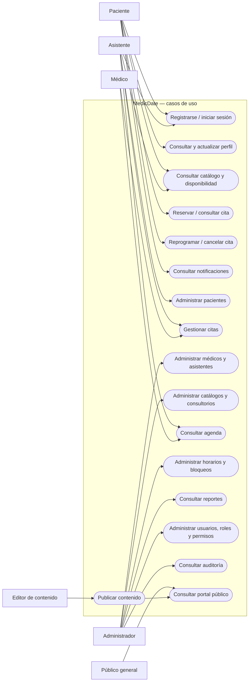
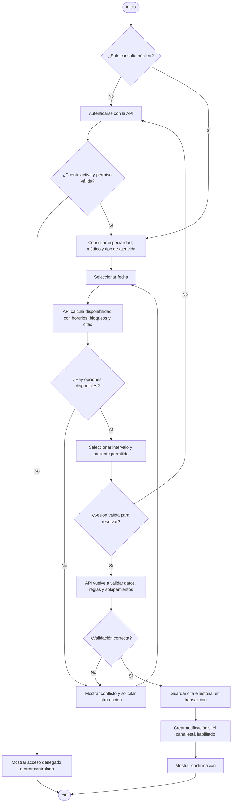
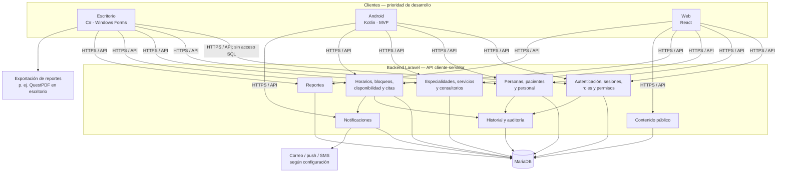
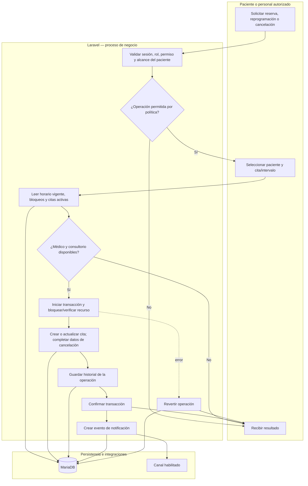

# Sistema Integral de Gestión de Citas Médicas para el Centro Médico Sagrado Corazón

> **Producto de referencia:** MedicDate. Este documento usa el nombre oficial del proyecto solicitado; MedicDate se conserva como nombre de la aplicación preexistente.

> **Estado:** resumen consolidado con las tres guías finales de desarrollo y la revisión previa de la base de datos y el escritorio legado. Sirve como base para iniciar el desarrollo; las políticas marcadas como pendientes aún requieren validación del centro médico. No acredita que todos los módulos estén implementados ni desplegados en producción.

## 1. Identificación y objetivo

El **Sistema Integral de Gestión de Citas Médicas para el Centro Médico Sagrado Corazón** es la evolución del producto MedicDate para apoyar la gestión de citas. La prioridad de desarrollo acordada por el usuario es **escritorio actualizado → Android → web**. El escritorio C# / Windows Forms se refactorizará para consumir exclusivamente las APIs Laravel; la aplicación Android usará Kotlin con MVP y la web usará React con Laravel bajo arquitectura cliente-servidor. Laravel constituye la capa compartida que debe estar disponible para cada cliente antes de su integración, sin cambiar el orden de prioridad de las plataformas.

El objetivo es organizar pacientes, profesionales, especialidades, consultorios, horarios y citas; facilitar que los pacientes consulten servicios y soliciten citas; y reducir errores de programación y conflictos de agenda. El código inspeccionado confirma un cliente de escritorio C# con Windows Forms y acceso a MySQL/MariaDB. La presencia de código no confirma por sí sola que cada módulo esté desplegado o aprobado por la clínica.

## 2. Problema y alcance

### Problema

La coordinación de citas, disponibilidad de médicos, consultorios y horarios puede producir duplicidades, conflictos, errores de captura y demoras. La atención a distancia también depende del contacto con el personal para conocer disponibilidad y reservar.

### Alcance propuesto por plataforma

| Plataforma | Usuarios principales | Funciones documentadas |
|---|---|---|
| Escritorio Windows | Administrador | Gestión de médicos y asistentes, especialidades, consultorios, horarios, usuarios y permisos; reportes administrativos. Se actualizará la aplicación C# / Windows Forms existente para consumir exclusivamente las APIs Laravel, sin conexión directa a MariaDB. |
| Móvil Android | Paciente | Registro/inicio de sesión, perfil, catálogo de especialidades y médicos, disponibilidad, reservación, consulta/cancelación de citas y notificaciones. Kotlin con arquitectura MVP, consumiendo las APIs Laravel. |
| Web | Asistente y médico; público general sin iniciar sesión | Portal informativo, autenticación y perfil, gestión y consulta de pacientes/citas, agendas y disponibilidad. Frontend React y backend Laravel mediante APIs, en arquitectura cliente-servidor. |

### Fuera del alcance confirmado de la versión de citas

- iOS, multi-sucursal/tenant, expediente clínico completo, telemedicina, pagos en línea e integración con terceros no están definidos como requisitos aprobados.
- El nuevo SQL es una propuesta de estructura vacía. **No migra ni transforma** los datos de `copia-estructura-v1.sql`.
- Las guías especifican la API REST como arquitectura objetivo. La implementación o disponibilidad de un prototipo debe verificarse en el repositorio de código y no se infiere de los documentos de diseño.

## 3. Usuarios y módulos

### Roles

- **Paciente:** administra su perfil y sus propias citas desde Android.
- **Asistente:** registra/busca pacientes y programa, modifica o cancela citas desde web, sujeto a las reglas autorizadas.
- **Médico:** consulta su agenda, disponibilidad y citas; las acciones permitidas sobre agenda siguen pendientes de confirmación.
- **Administrador:** gestiona personal, catálogos, permisos, horarios, reportes y auditoría desde escritorio.
- **Público general:** consulta contenido público del portal sin autenticación.

La nueva estructura permite asignar más de un rol a una cuenta y relaciona roles con permisos identificados por código; esa flexibilidad técnica no sustituye la matriz de autorización que el centro debe aprobar ni los controles de acceso que el backend debe aplicar.

### Módulos

**Escritorio (prioridad 1):** acceso y sesión; panel; pacientes; médicos y asistentes; especialidades y tipos de atención; consultorios; horarios y bloqueos; agenda y citas; perfil médico; reportes.  
**Android (prioridad 2):** autenticación/registro; perfil de paciente; catálogo de servicios; reservación; mis citas; notificaciones.  
**Web (prioridad 3):** portal informativo; autenticación/perfil; gestión de pacientes; citas; agenda médica; consulta de disponibilidad; administración de contenido y reportes conforme a permisos aprobados.

Los módulos base de la guía Fase 2 son W01–W06 para web y M01–M06 para Android. La administración de contenido, los reportes web y otras funciones no enumeradas ahí son extensiones propuestas en este resumen y deben aprobarse antes de incorporarlas al alcance comprometido. Todos los módulos deben vincularse a requisitos aceptados, criterios de aceptación y pruebas por plataforma.

### Descripción funcional de módulos

Las descripciones siguientes consolidan la funcionalidad prevista y lo observado en el escritorio legado. No significan que cada función ya esté desplegada ni reemplazan la autorización del centro médico.

#### Servicios compartidos en Laravel

| Módulo | Descripción |
|---|---|
| API y acceso | Proveer endpoints versionados para React, Android y WinForms; validar identidad, sesión, entradas y permisos del lado servidor. Ningún cliente se conecta directamente a MariaDB. |
| Usuarios, roles y permisos | Crear y administrar cuentas, asignar roles y aplicar permisos por operación y recurso. Los roles iniciales del SQL no constituyen por sí solos una matriz de permisos aprobada. |
| Perfiles y personas | Mantener datos de contacto y perfiles diferenciados de paciente y empleado; aplicar las reglas aprobadas para actualización y acceso a datos sensibles. |
| Personal médico y administrativo | Administrar empleados, asistentes y médicos; asociar cédulas profesionales y datos de contratación; habilitar o deshabilitar registros sin perder historial. |
| Catálogos clínico-administrativos | Administrar especialidades, tipos de atención, duración y costo de referencia, y consultorios. Los catálogos inactivos no deben ofrecerse para nuevas reservas. |
| Horarios y bloqueos | Configurar disponibilidad recurrente del médico, consultorio, vigencias y duración de intervalos; registrar bloqueos y ausencias. La validación de cruces debe ser transaccional en el backend. |
| Citas | Consultar disponibilidad y ejecutar alta, consulta, reprogramación, cancelación y transiciones autorizadas de estado. Una operación debe verificar solapamientos del médico y, si aplica, del consultorio antes de confirmar. |
| Historial y auditoría | Registrar cambios de estado de cita y eventos relevantes de acceso/administración con usuario, fecha, módulo y resultado; limitar el acceso y evitar guardar secretos o datos clínicos innecesarios. |
| Notificaciones | Crear y seguir avisos asociados a una cuenta/cita, controlar canal y resultado de envío y permitir consulta/lectura. Canales, consentimiento y reintentos requieren definición operativa. |
| Contenido informativo | Gestionar borradores, publicación y archivo del contenido público que presenta el portal; guardar autor y fechas de publicación. |
| Reportes | Entregar datos agregados y listados autorizados para agenda, estado e ingresos. El escritorio actual genera PDF con QuestPDF; en la arquitectura objetivo sus datos deben provenir de la API. |
| Recuperación y sesiones | Controlar expiración/revocación de sesiones y tokens de recuperación/verificación; persistir hashes de tokens, no el valor secreto. |

#### Aplicación web — React

| Módulo | Descripción |
|---|---|
| Portal público | Mostrar contenido informativo publicado, servicios y especialidades sin exponer datos privados ni funcionalidades internas. |
| Autenticación y cuenta | Iniciar/cerrar sesión, recuperar acceso y administrar la cuenta según los roles y flujos que autorice la clínica. |
| Gestión de pacientes | Permitir al personal autorizado buscar, consultar, registrar y actualizar perfiles; restringir campos sensibles y conservar trazabilidad. |
| Personal y catálogos | Ofrecer al personal con permisos la gestión de médicos, asistentes, especialidades, tipos de atención y consultorios. |
| Agenda médica | Consultar citas por médico, fecha y estado; mostrar detalles necesarios para la atención con autorización por rol. |
| Horarios y bloqueos | Crear, modificar, activar/desactivar horarios y registrar indisponibilidades para los usuarios autorizados. |
| Gestión de citas | Consultar disponibilidad y reservar, modificar o cancelar citas según reglas aprobadas; informar conflictos y resultado de la operación. |
| Administración de contenido | Preparar, publicar y archivar contenido informativo del portal para el rol autorizado. |
| Reportes y auditoría | Consultar reportes e historial de acciones permitidos; no otorgar acceso general a datos clínicos ni a logs completos. |

#### Aplicación móvil — Kotlin con MVP

| Módulo | Descripción |
|---|---|
| Presentación y navegación | Vistas Android para los flujos de paciente; el Presenter coordina eventos y estado de vista, y el Model accede a las APIs Laravel. |
| Registro y acceso | Registrar/iniciar/cerrar sesión, verificar cuenta y solicitar recuperación de contraseña mediante las APIs. |
| Perfil de paciente | Consultar y actualizar los datos personales permitidos del paciente autenticado. |
| Catálogo | Consultar especialidades, médicos y tipos de atención activos que el paciente puede reservar. |
| Disponibilidad | Buscar opciones de fecha y hora según horario, duración y bloqueos devueltos por la API; la disponibilidad mostrada es informativa hasta confirmar la reserva en servidor. |
| Reservación | Solicitar una cita y mostrar confirmación o conflicto; la API vuelve a validar disponibilidad de forma transaccional. |
| Mis citas | Consultar próximas y anteriores, abrir detalles y solicitar cancelación o reprogramación sujeto a las políticas aprobadas. |
| Notificaciones | Consultar avisos de la cuenta y el estado de lectura; el canal push y el consentimiento se deben aprobar. |

#### Aplicación de escritorio — C# / Windows Forms

El cliente actual incluye formularios de acceso, administración, pacientes, médicos, asistentes, especialidades, horarios, citas/agendas, perfil del médico y reportes. La refactorización conservará los flujos aprobados, pero reemplazará el acceso SQL de sus DAL por clientes HTTP de las APIs Laravel.

| Módulo | Descripción |
|---|---|
| Acceso y sesión | Autenticar contra Laravel, mantener la sesión de cliente con seguridad y cerrar/revocar acceso al salir o expirar. No validar contraseñas contra la base desde WinForms. |
| Panel administrativo | Presentar navegación/resumen de tareas según permisos; el contenido exacto del tablero debe confirmarse con usuarios. |
| Pacientes | Buscar, listar, registrar y editar pacientes desde formularios existentes, preservando datos y validaciones aprobadas a través de endpoints. |
| Médicos y asistentes | Mantener información de empleados y sus perfiles profesionales/administrativos, asociando cuentas y roles mediante la API. |
| Especialidades y tipos de atención | Mantener catálogos requeridos para búsqueda y reservación; tipos de atención y duración son parte del esquema nuevo y deben incorporarse al proceso de cita. |
| Consultorios | Crear y mantener ubicaciones de atención para asociarlas a horarios y citas si el centro confirma su uso operativo. |
| Horarios y bloqueos | Configurar la agenda recurrente y excepciones mediante la API; prevenir solapamientos en el servidor. |
| Agenda y citas | Consultar citas, disponibilidad y detalle; registrar, editar y cancelar solo con validación del servidor. |
| Perfil médico | Mostrar la agenda del profesional autenticado y permitir únicamente acciones aprobadas para su rol. |
| Reportes | Solicitar datos autorizados a Laravel y presentar/exportar reportes. Si la generación PDF permanece en QuestPDF, WinForms genera el documento a partir de la respuesta autorizada de API, no consultando SQL. |

### Procesos del sistema

| ID | Proceso | Actor iniciador | Resumen y resultado |
|---|---|---|---|
| P01 | Autenticación y autorización | Paciente, asistente, médico o administrador | La API valida credenciales/sesión, cuenta activa y permisos; registra el resultado y entrega acceso limitado al rol. |
| P02 | Registro de cuenta de paciente | Paciente | Captura datos permitidos, crea persona/perfil/cuenta según reglas, verifica contacto si se exige y deja la cuenta en el estado correspondiente. Reglas de auto-registro pendientes de aprobación. |
| P03 | Consulta de catálogo y disponibilidad | Paciente, asistente o médico | Filtra especialidad, médico, servicio y fecha; Laravel consulta horario vigente, bloqueos y citas activas, y devuelve opciones disponibles. |
| P04 | Alta de cita | Paciente o asistente autorizado | Valida identidad/permiso, paciente, médico, tipo de atención, horario, consultorio y cruces; guarda cita y evento de historial en una transacción; genera notificación si está configurada. |
| P05 | Reprogramación | Paciente o personal autorizado | Verifica política y propiedad/permiso, comprueba nuevo intervalo, actualiza cita e historial de forma atómica y notifica a los destinatarios permitidos. |
| P06 | Cancelación de cita | Paciente o personal autorizado | Comprueba plazo/reglas, marca cancelación con actor y fecha, registra historial y crea avisos cuando corresponda. |
| P07 | Atención y cambio de estado | Médico o personal autorizado | Consulta agenda; actualiza el estado permitido (por ejemplo, en progreso, completada o inasistencia) y registra autor, fecha y observación. |
| P08 | Administración de personal, roles y catálogos | Administrador autorizado | Crea/actualiza/desactiva perfiles y catálogos, asigna permisos aprobados y deja registro de auditoría. |
| P09 | Gestión de horarios y bloqueos | Administrador o rol delegado | Define vigencias, intervalo, consultorio y bloqueos; el servidor valida rangos y conflictos con la agenda existente antes de guardar. |
| P10 | Notificación | Sistema disparado por una operación | Crea aviso asociado a usuario/cita, intenta el canal configurado y registra estado/fecha/error sin incluir secretos. |
| P11 | Recuperación de acceso | Usuario | Solicita token, recibe un mecanismo fuera de banda, consume token no expirado y actualiza credenciales mediante un algoritmo de hash seguro. |
| P12 | Publicación de contenido | Editor autorizado | Guarda borrador, publica o archiva contenido y registra autor/fechas; el portal público solo muestra lo publicado. |
| P13 | Consulta y emisión de reportes | Administrador o personal autorizado | Solicita métricas/listados para un rango; la API valida permisos y filtros, y la interfaz presenta o exporta el resultado. |
| P14 | Auditoría | Sistema / administrador autorizado | Registra eventos de seguridad y administración; personal autorizado consulta solo la información permitida y conforme a retención. |

### Diagramas funcionales

Los diagramas describen la arquitectura y los procesos objetivo; las políticas marcadas como pendientes deben confirmarse con la clínica antes de convertirlas en comportamiento definitivo.

#### Diagrama de usuarios y casos de uso



El actor editor de contenido es una función asignable por permisos, no necesariamente un rol separado. Las acciones de pacientes, médicos y asistentes dependen de la matriz de acceso pendiente de aprobación.

#### Diagrama de flujo general de una cita



#### Diagrama de módulos y arquitectura



Prioridad de desarrollo acordada: **actualización del escritorio WinForms → Android Kotlin/MVP → web React**. Laravel/API es un habilitador transversal: los endpoints requeridos para cada etapa deben construirse y validarse antes de conectar ese cliente. Esto mantiene la prioridad solicitada sin duplicar reglas de negocio ni permitir acceso SQL directo desde las aplicaciones.

#### Diagrama de procesos de reserva, reprogramación y cancelación



Las transacciones, el control de concurrencia y las reglas de reprogramación/cancelación deben implementarse y probarse en Laravel. El diagrama no presupone un plazo de cancelación ni un canal de notificación ya aprobado.

## 4. Metodología de trabajo

La guía final de Fase 2 propone como línea de trabajo **Scrum para la gestión y Extreme Programming (XP) para prácticas de ingeniería**, en iteraciones cortas. El plan documental contempla cuatro sprints de dos semanas (ocho semanas en total), con planeación, seguimiento, revisión y retrospectiva. XP incluye programación en parejas, pruebas automatizadas de disponibilidad/concurrencia, integración continua, refactorización y diseño simple. La asignación de Product Owner, Scrum Master y responsabilidades del equipo debe formalizarse antes de iniciar.

El plan de ocho semanas de Fase 2 cubre la ampliación descrita para servicios compartidos, web y móvil; la adaptación de escritorio se considera en el trabajo de API, pero su ubicación y esfuerzo deben replanificarse para respetar la prioridad actual **escritorio → Android → web**. No equivale a las cotizaciones separadas de tres y siete meses ni a una estimación aprobada para el sistema integral. La guía de reparto plantea además una entrega de dos semanas y deja funciones para el quinto semestre; se presenta como propuesta pendiente de aprobación, no como calendario definitivo ni como alcance completo.

Etapas de trabajo documentadas:

1. Validar problema, actores, proceso actual y reglas con entrevistas/observación y conservar evidencia autorizada.
2. Diseñar procesos, modelo de datos, interfaces y contratos de API antes de integrar cada cliente.
3. Implementar por incrementos priorizados, comenzando por el escritorio y los servicios que requiere; seguir con Android y después web.
4. Mantener requisitos priorizados, versionados y trazables a procesos, pantallas, tablas, endpoints y pruebas; revisar entregas y registrar acuerdos.
5. Probar autorización, reglas de agenda y concurrencia, privacidad, usabilidad, integración y recuperación antes de liberar.

## 5. Arquitectura y tecnologías

| Componente | Base documental | Estado y observaciones |
|---|---|---|
| Escritorio | C#, Windows Forms, .NET 8 para Windows | Confirmado en `MedicDate.csproj`. Se refactorizará para usar las APIs Laravel exclusivamente. El código separa formularios (`CapaPresentacion`), modelos (`Datos`) y acceso/lógica (`Procesos`), pero sus DAL actuales consultan directamente la base y deben sustituirse/adaptarse. |
| Web | React (frontend) y Laravel (backend) | Decisión confirmada por el usuario. Arquitectura cliente-servidor: React consume APIs Laravel; el backend aplica reglas de negocio, autenticación y autorización. Se desarrolla después de escritorio y Android. |
| Android | Kotlin y arquitectura MVP | Decisión confirmada. La aplicación móvil consumirá las mismas APIs Laravel; concretar bibliotecas, versiones y distribución en el diseño técnico. |
| Persistencia | MySQL/MariaDB; cliente `MySqlConnector` 2.6.1 en el proyecto inspeccionado | El dump legado apunta a `innegone_bd_medic`; el esquema multiplataforma es otro esquema y no es intercambiable sin migración y adaptación del cliente. |
| Reportes | QuestPDF 2026.7.2 | Dependencia del cliente de escritorio; `clsReporteDAL` obtiene información de la base y genera reportes PDF. |
| Integración | API REST Laravel | Es la única frontera de acceso para React, Android y el escritorio actualizado; ningún cliente se conectará directamente a MariaDB. Los contratos, versionado y permisos deben definirse antes de integrar cada cliente. |
| Organización | Cliente-servidor; backend Laravel centralizado | Las reglas de negocio y acceso a datos residen en Laravel. React, Android y WinForms son clientes de API; los patrones internos del backend deben concretarse en el diseño técnico. |

**Frameworks y arquitecturas:** web con React y Laravel en arquitectura cliente-servidor; Android nativo con Kotlin y arquitectura MVP; escritorio existente en C# / Windows Forms sobre .NET 8, pendiente de actualización para usar únicamente las APIs Laravel. La guía Fase 2 menciona PHP para web, sin especificar Laravel; Laravel se incorpora por la decisión posterior del usuario. La guía también propone Repository para organizar acceso a datos, a confirmar en el diseño técnico. QuestPDF se utiliza actualmente en reportes del escritorio. No se atribuye Spring Boot, Thymeleaf ni MVVM a MedicDate: aparecen en materiales de otros proyectos.

## 6. Modelo de datos normalizado (Versión 2.1)

El esquema definitivo normalizado se consolida bajo el nombre [`innegone_bd_medicdate`](./medicdate_multiplataforma_v2.sql) (versión 2.1), diseñado en Tercera Forma Normal (3FN) con un total de **31 tablas**. Este modelo unifica los requerimientos de la aplicación de escritorio C# / Windows Forms, la aplicación móvil Android Kotlin, el portal web React y la API REST centralizada en Laravel. El diseño incorpora las tablas de domicilios (`municipio` y `direccion`), unifica los servicios clínicos y públicos en `tipo_atencion`, establece el origen de agendamiento (`canal_registro`), garantiza la asignación obligatoria de médico en cada cita y soporta tanto la recuperación mediante tokens como desafíos mediante preguntas secretas.

### Entidades principales (31 tablas)

- **Identidad y acceso (6):** `persona`, `usuario`, `rol`, `permiso`, `rol_permiso`, `usuario_rol`.
- **Ubicación y domicilios (2):** `municipio`, `direccion`.
- **Perfiles (4):** `paciente`, `empleado`, `asistente`, `doctor`.
- **Catálogos y capacidad (5):** `especialidad`, `doctor_especialidad`, `consultorio`, `tipo_atencion` (unificada con servicios web), `horario_atencion`, `bloqueo_horario`.
- **Operación de citas (3):** `cita` (con médico obligatorio y canal de registro), `historial_cita`, `notificacion`.
- **Sesiones y seguridad (4):** `sesion_usuario`, `token_recuperacion`, `pregunta_secreta`, `usuario_pregunta_secreta`.
- **Portal web público e institucional (5):** `centro_medico` (singleton institucional), `hero_slide`, `resena` (admite pacientes y público externo), `pregunta_frecuente`, `contenido_informativo`, `auditoria`.

El diseño emplea claves foráneas explícitas con políticas de integridad referencial (`ON DELETE RESTRICT`, `CASCADE` y `SET NULL`), restricciones `CHECK` avanzadas (intervalos temporales, coherencia de cancelación de citas, estrellas de reseñas y regla singleton), unicidad de cuentas, curp y cédulas, e índices optimizados para disponibilidad de agenda.

**Cotejo físico del diccionario:** las 31 tablas y sus columnas están exhaustivamente documentadas en el [`Diccionario de Datos`](./Sistema_Integral_Gestion_Citas_Medicas_Centro_Medico_Sagrado_Corazon_Diccionario_Datos.md).

#### Diagrama entidad-relación (ER)

El ER representa las 31 tablas del esquema normalizado y sus interrelaciones de integridad referencial.

```mermaid
erDiagram
  PERSONA ||--o| USUARIO : tiene
  PERSONA ||--o| PACIENTE : perfil
  PERSONA ||--o| EMPLEADO : perfil
  PERSONA ||--o{ DIRECCION : reside
  MUNICIPIO ||--o{ DIRECCION : ubica
  USUARIO ||--o{ USUARIO_ROL : recibe
  ROL ||--o{ USUARIO_ROL : asignado
  ROL ||--o{ ROL_PERMISO : incluye
  PERMISO ||--o{ ROL_PERMISO : autoriza
  EMPLEADO ||--o| ASISTENTE : especializa
  EMPLEADO ||--o| DOCTOR : especializa
  DOCTOR ||--o{ DOCTOR_ESPECIALIDAD : posee
  ESPECIALIDAD ||--o{ DOCTOR_ESPECIALIDAD : asignada
  ESPECIALIDAD ||--o{ TIPO_ATENCION : clasifica
  DOCTOR ||--o{ HORARIO_ATENCION : programa
  CONSULTORIO ||--o{ HORARIO_ATENCION : asignado
  DOCTOR ||--o{ BLOQUEO_HORARIO : bloqueado
  CONSULTORIO ||--o{ BLOQUEO_HORARIO : afecta
  USUARIO ||--o{ BLOQUEO_HORARIO : registra
  PACIENTE ||--o{ CITA : solicita
  DOCTOR ||--o{ CITA : atiende
  CONSULTORIO ||--o{ CITA : asignado
  TIPO_ATENCION ||--o{ CITA : define
  USUARIO ||--o{ CITA : registra
  USUARIO ||--o{ CITA : cancela
  CITA ||--o{ HISTORIAL_CITA : mantiene
  USUARIO ||--o{ HISTORIAL_CITA : ejecuta
  USUARIO ||--o{ SESION_USUARIO : inicia
  USUARIO ||--o{ TOKEN_RECUPERACION : solicita
  USUARIO ||--o{ USUARIO_PREGUNTA_SECRETA : responde
  PREGUNTA_SECRETA ||--o{ USUARIO_PREGUNTA_SECRETA : cataloga
  USUARIO ||--o{ NOTIFICACION : recibe
  CITA ||--o{ NOTIFICACION : relacionada
  USUARIO ||--o{ CONTENIDO_INFORMATIVO : redacta
  USUARIO ||--o{ AUDITORIA : genera
  PACIENTE ||--o{ RESENA : califica

  PERSONA {
    BIGINT id_persona PK
    VARCHAR nombres
    VARCHAR apellido_paterno
    VARCHAR correo_contacto
  }
  USUARIO {
    BIGINT id_usuario PK
    BIGINT id_persona FK
    VARCHAR correo_acceso
    VARCHAR password_hash
    ENUM estado
  }
  MUNICIPIO {
    INT id_municipio PK
    VARCHAR nombre
    VARCHAR estado
  }
  DIRECCION {
    BIGINT id_direccion PK
    BIGINT id_persona FK
    INT id_municipio FK
    VARCHAR calle
    VARCHAR numero
  }
  PACIENTE {
    BIGINT id_paciente PK
    BIGINT id_persona FK
    TEXT alergias
    ENUM estado
  }
  EMPLEADO {
    BIGINT id_empleado PK
    BIGINT id_persona FK
    CHAR curp
    ENUM estado
  }
  DOCTOR {
    BIGINT id_empleado PK, FK
    VARCHAR cedula_profesional
    TINYINT publicado
  }
  ASISTENTE {
    BIGINT id_empleado PK, FK
    VARCHAR turno
  }
  ESPECIALIDAD {
    INT id_especialidad PK
    VARCHAR nombre
    TINYINT activo
  }
  TIPO_ATENCION {
    INT id_tipo_atencion PK
    INT id_especialidad FK
    VARCHAR nombre
    SMALLINT duracion_minutos
    DECIMAL costo_base
    TINYINT publicado_web
  }
  CITA {
    BIGINT id_cita PK
    BIGINT id_paciente FK
    BIGINT id_empleado FK
    INT id_tipo_atencion FK
    DATETIME inicio
    DATETIME fin
    ENUM estado
    ENUM canal_registro
  }
  HISTORIAL_CITA {
    BIGINT id_historial PK
    BIGINT id_cita FK
    ENUM estado_nuevo
    DATETIME fecha_evento
  }
  SESION_USUARIO {
    BIGINT id_sesion PK
    BIGINT id_usuario FK
    CHAR token_hash
    ENUM plataforma
  }
  TOKEN_RECUPERACION {
    BIGINT id_token PK
    BIGINT id_usuario FK
    CHAR token_hash
    ENUM proposito
  }
  PREGUNTA_SECRETA {
    SMALLINT id_pregunta_secreta PK
    VARCHAR texto
    TINYINT activo
  }
  USUARIO_PREGUNTA_SECRETA {
    BIGINT id_usuario PK, FK
    SMALLINT id_pregunta_secreta PK, FK
    VARCHAR respuesta_hash
  }
  RESENA {
    BIGINT id_resena PK
    BIGINT id_paciente FK
    VARCHAR nombre_autor
    TINYINT estrellas
    TINYINT publicada
  }
  CENTRO_MEDICO {
    TINYINT id_centro PK
    VARCHAR nombre
    VARCHAR telefono
  }
  HERO_SLIDE {
    INT id_slide PK
    VARCHAR titulo
    SMALLINT orden
    TINYINT activo
  }
  PREGUNTA_FRECUENTE {
    INT id_pregunta_frecuente PK
    VARCHAR pregunta
    SMALLINT orden
  }
  NOTIFICACION {
    BIGINT id_notificacion PK
    BIGINT id_usuario FK
    BIGINT id_cita FK
    ENUM canal
  }
  AUDITORIA {
    BIGINT id_auditoria PK
    BIGINT id_usuario FK
    VARCHAR modulo
    VARCHAR accion
  }
```



#### Diagrama relacional

Este diagrama explicita los grupos funcionales y las relaciones foráneas (FK) implementadas en el SQL. `PK` identifica clave primaria; `FK` identifica clave foránea.

```mermaid
flowchart TB
  subgraph Identidad["Identidad, Seguridad y Domicilios"]
    P["persona<br/>PK id_persona"]
    U["usuario<br/>PK id_usuario<br/>FK id_persona"]
    R["rol<br/>PK id_rol"]
    PER["permiso<br/>PK id_permiso"]
    UR["usuario_rol<br/>PK/FK id_usuario, id_rol"]
    RP["rol_permiso<br/>PK/FK id_rol, id_permiso"]
    MUN["municipio<br/>PK id_municipio"]
    DIR["direccion<br/>PK id_direccion<br/>FK id_persona, id_municipio"]
    SU["sesion_usuario<br/>PK id_sesion<br/>FK id_usuario"]
    TR["token_recuperacion<br/>PK id_token<br/>FK id_usuario"]
    PS["pregunta_secreta<br/>PK id_pregunta_secreta"]
    UPS["usuario_pregunta_secreta<br/>PK/FK id_usuario, id_pregunta_secreta"]

    P -->|usuario.id_persona| U
    P -->|direccion.id_persona| DIR
    MUN -->|direccion.id_municipio| DIR
    U -->|usuario_rol.id_usuario| UR
    R -->|usuario_rol.id_rol| UR
    R -->|rol_permiso.id_rol| RP
    PER -->|rol_permiso.id_permiso| RP
    U -->|sesion_usuario.id_usuario| SU
    U -->|token_recuperacion.id_usuario| TR
    U -->|usuario_pregunta_secreta.id_usuario| UPS
    PS -->|usuario_pregunta_secreta.id_pregunta_secreta| UPS
  end

  subgraph Perfiles["Perfiles y Catálogos Clínicos"]
    PA["paciente<br/>PK id_paciente<br/>FK id_persona"]
    E["empleado<br/>PK id_empleado<br/>FK id_persona"]
    A["asistente<br/>PK/FK id_empleado"]
    D["doctor<br/>PK/FK id_empleado"]
    ES["especialidad<br/>PK id_especialidad"]
    DE["doctor_especialidad<br/>PK/FK id_empleado, id_especialidad"]
    CO["consultorio<br/>PK id_consultorio"]
    TA["tipo_atencion (Servicios unificados)<br/>PK id_tipo_atencion<br/>FK id_especialidad"]

    P -->|paciente.id_persona| PA
    P -->|empleado.id_persona| E
    E -->|asistente.id_empleado| A
    E -->|doctor.id_empleado| D
    D -->|doctor_especialidad.id_empleado| DE
    ES -->|doctor_especialidad.id_especialidad| DE
    ES -->|tipo_atencion.id_especialidad| TA
  end

  subgraph Agenda["Agenda, Citas y Trazabilidad"]
    H["horario_atencion<br/>PK id_horario<br/>FK id_empleado, id_consultorio"]
    B["bloqueo_horario<br/>PK id_bloqueo<br/>FK id_empleado, consultorio, usuario"]
    C["cita<br/>PK id_cita<br/>FK paciente, doctor, consultorio, tipo_atencion"]
    HC["historial_cita<br/>PK id_historial<br/>FK id_cita, id_usuario"]

    D -->|horario_atencion.id_empleado| H
    CO -.->|horario_atencion.id_consultorio| H
    D -->|bloqueo_horario.id_empleado| B
    CO -.->|bloqueo_horario.id_consultorio| B
    U -->|bloqueo_horario.id_usuario_registro| B
    PA -->|cita.id_paciente| C
    D -->|cita.id_empleado (NOT NULL)| C
    CO -.->|cita.id_consultorio| C
    TA -->|cita.id_tipo_atencion| C
    U -->|cita.id_usuario_registro| C
    U -.->|cita.id_usuario_cancelacion| C
    C -->|historial_cita.id_cita| HC
    U -.->|historial_cita.id_usuario| HC
  end

  subgraph Portal["Portal Público, Comunicación y Auditoría"]
    CM["centro_medico<br/>PK id_centro = 1"]
    HS["hero_slide<br/>PK id_slide"]
    RES["resena<br/>PK id_resena<br/>FK id_paciente nullable"]
    FAQ["pregunta_frecuente<br/>PK id_pregunta_frecuente"]
    N["notificacion<br/>PK id_notificacion<br/>FK usuario, cita"]
    CI["contenido_informativo<br/>PK id_contenido<br/>FK id_usuario_autor"]
    AU["auditoria<br/>PK id_auditoria<br/>FK id_usuario"]

    PA -.->|resena.id_paciente nullable| RES
    U -->|notificacion.id_usuario| N
    C -.->|notificacion.id_cita| N
    U -.->|contenido_informativo.id_usuario_autor| CI
    U -.->|auditoria.id_usuario| AU
  end
```

**Relaciones en notación relacional (PK / FK) — 31 tablas:**

| Tabla | Clave primaria | Claves foráneas e integridad referencial |
|---|---|---|
| `persona` | `id_persona` | — |
| `usuario` | `id_usuario` | `id_persona → persona.id_persona` (UQ, RESTRICT) |
| `rol` | `id_rol` | — |
| `permiso` | `id_permiso` | — |
| `usuario_rol` | (`id_usuario`, `id_rol`) | `id_usuario → usuario.id_usuario` (CASCADE); `id_rol → rol.id_rol` (RESTRICT) |
| `rol_permiso` | (`id_rol`, `id_permiso`) | `id_rol → rol.id_rol` (CASCADE); `id_permiso → permiso.id_permiso` (RESTRICT) |
| `municipio` | `id_municipio` | — |
| `direccion` | `id_direccion` | `id_persona → persona.id_persona` (CASCADE); `id_municipio → municipio.id_municipio` (SET NULL) |
| `paciente` | `id_paciente` | `id_persona → persona.id_persona` (UQ, RESTRICT) |
| `empleado` | `id_empleado` | `id_persona → persona.id_persona` (UQ, RESTRICT) |
| `asistente` | `id_empleado` | `id_empleado → empleado.id_empleado` (RESTRICT) |
| `doctor` | `id_empleado` | `id_empleado → empleado.id_empleado` (RESTRICT) |
| `especialidad` | `id_especialidad` | — |
| `doctor_especialidad` | (`id_empleado`, `id_especialidad`) | `id_empleado → doctor.id_empleado` (RESTRICT); `id_especialidad → especialidad.id_especialidad` (RESTRICT) |
| `consultorio` | `id_consultorio` | — |
| `tipo_atencion` | `id_tipo_atencion` | `id_especialidad → especialidad.id_especialidad` (nullable, RESTRICT) |
| `horario_atencion` | `id_horario` | `id_empleado → doctor.id_empleado` (RESTRICT); `id_consultorio → consultorio.id_consultorio` (nullable, RESTRICT) |
| `bloqueo_horario` | `id_bloqueo` | `id_empleado → doctor.id_empleado` (RESTRICT); `id_consultorio → consultorio.id_consultorio` (nullable, RESTRICT); `id_usuario_registro → usuario.id_usuario` (RESTRICT) |
| `cita` | `id_cita` | `id_paciente → paciente.id_paciente` (RESTRICT); `id_empleado → doctor.id_empleado` (RESTRICT); `id_consultorio → consultorio.id_consultorio` (nullable, RESTRICT); `id_tipo_atencion → tipo_atencion.id_tipo_atencion` (RESTRICT); `id_usuario_registro → usuario.id_usuario` (RESTRICT); `id_usuario_cancelacion → usuario.id_usuario` (nullable, SET NULL) |
| `historial_cita` | `id_historial` | `id_cita → cita.id_cita` (RESTRICT); `id_usuario → usuario.id_usuario` (nullable, SET NULL) |
| `sesion_usuario` | `id_sesion` | `id_usuario → usuario.id_usuario` (RESTRICT) |
| `token_recuperacion` | `id_token` | `id_usuario → usuario.id_usuario` (RESTRICT) |
| `pregunta_secreta` | `id_pregunta_secreta` | — |
| `usuario_pregunta_secreta` | (`id_usuario`, `id_pregunta_secreta`) | `id_usuario → usuario.id_usuario` (CASCADE); `id_pregunta_secreta → pregunta_secreta.id_pregunta_secreta` (RESTRICT) |
| `notificacion` | `id_notificacion` | `id_usuario → usuario.id_usuario` (RESTRICT); `id_cita → cita.id_cita` (nullable, SET NULL) |
| `contenido_informativo` | `id_contenido` | `id_usuario_autor → usuario.id_usuario` (nullable, SET NULL) |
| `auditoria` | `id_auditoria` | `id_usuario → usuario.id_usuario` (nullable, SET NULL) |
| `centro_medico` | `id_centro` | — (CHECK `id_centro = 1`) |
| `hero_slide` | `id_slide` | — |
| `resena` | `id_resena` | `id_paciente → paciente.id_paciente` (nullable, SET NULL) |
| `pregunta_frecuente` | `id_pregunta_frecuente` | — |

**Observaciones de integridad del modelo:** El esquema garantiza 3FN al desacoplar domicilios en `direccion`/`municipio`, unificar servicios en `tipo_atencion`, preservar trazabilidad estricta de citas sin borrados accidentales mediante `RESTRICT`, y brindar flexibilidad para preguntas secretas únicas o en set. La definición SQL completa se encuentra en [`medicdate_multiplataforma_v2.sql`](./medicdate_multiplataforma_v2.sql).

### 6.1 Compatibilidad con el escritorio existente

Se inspeccionaron el proyecto `version1 escritorio/MedicDate`, el dump `copia-estructura-v1.sql` y la documentación de escritorio. El código implementa formularios para pacientes, doctores, asistentes, especialidades, horarios, citas/agendas, perfil del doctor, acceso y reportes. Sus clases DAL consultan directamente tablas y columnas del esquema legado; por tanto, el escritorio **no puede apuntarse sin cambios** a `innegone_bd_medicdate`.

| Contrato usado por el escritorio | Diferencia en el esquema nuevo | Impacto |
|---|---|---|
| Esquema `innegone_bd_medic` y consultas directas desde `clsConexion`/DAL | El SQL crea `innegone_bd_medicdate` (versión 2.1); el cliente destino debe consumir APIs Laravel | Cambiar solo la cadena de conexión deja la app apuntando a una base que no contiene su contrato de tablas y contraviene la arquitectura objetivo. |
| `paciente` contiene `nombre`, apellidos, teléfonos, dirección, `id_municipio`, alergias y notas; el modelo C# usa IDs `int` | Los datos personales pasan a `persona`, `paciente` referencia `id_persona`, y los domicilios se normalizan en `direccion` y `municipio` | Se rompen consultas directas del DAL legado, pantallas y tipos de datos; la nueva API Laravel centraliza la lectura y escritura normalizada de domicilios y pacientes. |
| `empleado` contiene datos personales, `tipo_empleado`, `estado` e `id_usuario`; `doctor` enlaza por `id_empleado` y usa especialidad principal/consultorio | Se normaliza la persona, el empleado y el usuario; cambia la relación de especialidades y consultorio | Se rompen joins, formularios, filtrado por tipo y persistencia de doctores/asistentes. |
| `usuario(usuario, contrasena, id_rol, activo)` | `usuario(correo_acceso, password_hash, estado)` más `usuario_rol` | El login, alta de cuentas y autorización deben adaptarse; un cambio de esquema no convierte ni valida contraseñas existentes. |
| `cita(id_doctor, fecha, hora, duracion, estado, id_registrado_por)` y estados con espacios/mayúsculas | `id_empleado`, `inicio`/`fin`, tipo de atención obligatorio, usuario de registro obligatorio y estados normalizados | Se rompen alta/edición, grillas, filtros y reportes. Deben mapearse duración/fin, estados, usuario responsable y valores históricos. |
| `horario(id_doctor, dia_semana` como texto, `intervalo_atencion`, `activo`) | `horario_atencion`, día ISO numérico, vigencia y campos renombrados | Se rompen consultas de horario y cálculo de disponibilidad que espera nombres de días en español. |
| IDs de entidades principales como `INT` y modelos C# como `int` | Varias claves nuevas son `BIGINT UNSIGNED` | Riesgo de incompatibilidad al convertir IDs con `Convert.ToInt32`; el contrato debe conservar IDs actuales o evolucionar todos los tipos relacionados y probarlos. |
| `doctor_especialidad` y reportes consultan campos/nombres legados | Parte de la relación puede mantenerse, pero las tablas y columnas referidas cambian | Cada consulta de reportes, filtros y catálogos requiere adaptación y pruebas, no solo cambios de DDL. |

**Recomendación de decisión:** no sustituir el esquema legado por el SQL multiplataforma ni usarlo en producción como si fuera compatible con la versión 1. El SQL actual es un modelo objetivo separado, no una migración ni una capa de compatibilidad. Laravel debe actuar como única capa de negocio y persistencia para todos los clientes. La normalización de `persona`/`usuario`, las citas por intervalo y el cambio de roles necesitan un mapeo explícito y pruebas antes de adoptarse. Durante la transición, mantener el cliente legado y su base operativos hasta contar con APIs y una estrategia probada de migración; evitar escrituras divergentes entre dos modelos de datos. Las vistas de compatibilidad solo son opción para consultas que se demuestren compatibles; no resuelven automáticamente altas/actualizaciones ni reglas de negocio.

**Debilidades observadas en el código que conviene corregir en la prioridad de escritorio:**

- `ValidarYPrepararCita` omite la validación si se edita una cita y se conserva la misma fecha; eso puede permitir guardar un cambio de hora o médico sin volver a comprobar disponibilidad.
- La lista de horas disponibles asume intervalos fijos de 30 minutos y compara horas de inicio ocupadas; el guardado sí tiene una comprobación de intersección por duración, pero se ejecuta aparte de la escritura. Una reserva simultánea desde otra sesión puede pasar entre ambas operaciones. Leer el intervalo configurado y hacer validación/escritura en una transacción segura para concurrencia.
- El código de autenticación usa SHA-256 simple y acepta temporalmente contraseñas almacenadas en texto plano. Diseñar una transición a un algoritmo de hash de contraseñas con sal y factor de costo, sin bloquear cuentas existentes ni conservar la compatibilidad en texto plano indefinidamente.
- `App.config` incluye credenciales de conexión a la base en el cliente. Rotar las credenciales afectadas y retirar el acceso directo del cliente a la base; la API debe ser el límite de acceso para los clientes multiplataforma.

**Orden de evolución acordado:**

1. **Escritorio actualizado (prioridad 1):** construir y validar los servicios Laravel que requiera el cliente; refactorizar C# / Windows Forms para que login, catálogos, agenda, disponibilidad y reportes dependan exclusivamente de las APIs. Retirar el acceso directo y las credenciales de base de datos del cliente; preservar los flujos aprobados mediante pruebas de regresión.
2. **Móvil Android (prioridad 2):** desarrollar la aplicación Kotlin con MVP sobre las APIs Laravel validadas; probar permisos y flujos específicos del paciente.
3. **Web (prioridad 3):** desarrollar React como cliente de las APIs existentes, con portal informativo y funciones autorizadas para asistentes y médicos.

La prioridad ordena el desarrollo de cada plataforma; el backend y los cambios de datos son trabajo compartido habilitador, no una plataforma que altere la secuencia. No exponer MariaDB a los clientes.

Las capturas recibidas son consistentes con las funciones de administración, agenda, consulta y edición descritas, pero no prueban por sí solas el comportamiento ni la cobertura de producción. La documentación de la primera versión ayuda a entender el propósito y Scrum; el código fuente se toma como evidencia de tecnologías y consultas reales.

### Decisiones del esquema que requieren cuidado

- La base de datos no puede impedir por sí sola todo traslape de intervalos con distinta duración usando una clave `UNIQUE` ordinaria. El backend debe crear/cancelar/modificar citas dentro de transacciones, serializar operaciones sobre médico y consultorio y volver a verificar intersecciones de horario antes de confirmar. Deben añadirse pruebas de dos reservas simultáneas.
- Los identificadores de sesión y recuperación se almacenan como hashes; la aplicación debe generar tokens aleatorios de alta entropía, guardar únicamente su hash, limitar su uso y expiración, y no registrar valores secretos.
- `alergias`, `notas_medicas`, `motivo` y `notas_internas` pueden revelar información sensible. El acceso debe limitarse por rol y necesidad; deben definirse cifrado, auditoría, retención y eliminación conforme a las políticas del centro y obligaciones aplicables.
- La zona horaria y la interpretación de `DATETIME` deben formalizarse antes de integrar clientes en distintas zonas o servicios externos.
- El esquema no incluye un expediente clínico longitudinal ni datos multi-sucursal; no deben incorporarse sin ampliar el alcance y revisar permisos/retención.

## 7. Revisión crítica del esquema anterior

### Fortalezas que se conservan

- InnoDB, claves foráneas y algunos índices ya protegen integridad y consultas frecuentes.
- Se identifican entidades relevantes: pacientes, empleados, médicos, especialidades, horarios, citas, usuarios y roles.
- El modelo contempla historial de actualización básico y un usuario responsable de registrar la cita.
- `doctor_especialidad` ya representa una relación varios-a-varios, además de existir especialidad principal.

### Debilidades y correcciones recomendadas

1. **Codificación mixta:** la base se declara `latin1` pero muchas tablas usan `utf8mb4`. El nuevo esquema estandariza base y tablas en `utf8mb4`; la conversión de registros requiere una migración separada y pruebas de acentos/collation.
2. **Tablas ajenas al dominio:** `productos`, `imagenes_producto` y `categorias` parecen pertenecer a comercio, no a citas médicas. No se replican en MedicDate.
3. **Acceso de pacientes:** el esquema anterior no enlaza claramente paciente con cuenta; sí vincula `empleado` con `usuario`, lo que dificulta el registro y aislamiento de citas del paciente.
4. **Roles duplicados/limitados:** `tipo_empleado`, tablas por perfil y `rol` no forman un modelo uniforme. El nuevo diseño centraliza autorizaciones con `usuario_rol` y conserva los perfiles de médico/asistente.
5. **Datos de cita incompletos:** la cita antigua guarda fecha y hora separadas, duración, médico y paciente, pero no vincula consultorio ni tipo de atención. Tampoco tiene fin explícito ni un estado para inasistencia. El nuevo modelo añade fin, consultorio, servicio y estados del proceso.
6. **Disponibilidad insuficiente:** no se representa de forma completa la asignación de consultorio, vigencia del horario, bloqueos/ausencias y colisiones. `horario_atencion` y `bloqueo_horario` incorporan esos datos básicos; las reglas de conflicto permanecen en backend y requieren pruebas concurrentes.
7. **Autenticación sin política explícita:** `contrasena` no indica algoritmo, flujo de recuperación, expiración de sesión o verificación de correo. El nuevo nombre `password_hash` no garantiza por sí solo un hash seguro: la aplicación debe usar un algoritmo de contraseñas vigente, sal y parámetros configurados, y nunca guardar contraseña ni token en claro.
8. **Auditoría y notificaciones ausentes:** los cambios, notificaciones y fallos de envío no tienen entidades dedicadas. Se proponen `historial_cita`, `notificacion` y `auditoria`, con acceso restringido y sin guardar secretos.
9. **Eliminaciones y conservación:** hay relaciones con borrado en cascada que podrían borrar perfiles necesarios para conservar historia. El nuevo diseño restringe el borrado de entidades relacionadas; el ciclo de vida y la anonimización se deben acordar.
10. **Campos clínicos antiguos:** el dump guarda alergias, notas médicas y notas internas sin expresar control de acceso, finalidad ni retención. Se conservan campos compatibles en el borrador por continuidad funcional, pero deben revisarse antes de producción y quizá excluirse si la plataforma no gestionará información clínica.
11. **Reglas de negocio no garantizadas por el SQL:** un `ENUM` de estado o un índice no aplica plazos de reservación/cancelación ni impide traslapes de intervalos; esas reglas deben validarse en transacciones del backend y probarse.
12. **Sin migración ni compatibilidad de escritorio:** por decisión de alcance, el SQL no convierte `innegone_bd_medic` y su modelo no conserva los contratos directos de la versión WinForms. Antes de adoptarlo se requiere inventariar datos y consultas, mapear IDs/catálogos, resolver duplicados, adaptar el cliente o definir una capa compatible y diseñar respaldo, ensayo de migración, regresión y reversión.
13. **Diferencias entre entregables de Fase 2:** `MedicDate_Fase2_corregido.docx` especifica módulos web/móvil, arquitectura cliente-servidor con API REST, C# / Windows Forms, React, Kotlin/Android, patrón Repository como propuesta, Scrum+XP, cuatro sprints de dos semanas y una estimación académica de 500 horas. La guía de reparto propone una entrega distinta de dos semanas con funciones explícitamente pendientes para el quinto semestre. Ninguno de esos calendarios debe confundirse con las cotizaciones de tres/siete meses. La decisión posterior del usuario cambia el orden de plataformas a escritorio → Android → web y define Laravel como backend; debe reflejarse así en el backlog y cronograma ejecutables.
14. **Requisitos no funcionales con valores aún por aprobar:** Fase 2 ya propone 95 % de consultas en menos de 2 segundos, confirmación en menos de 3 segundos con 50 usuarios concurrentes, 99 % de disponibilidad mensual en horario de atención y respaldo diario con 30 días de retención, RPO de 24 horas y prueba trimestral de restauración. Deben validarse con la infraestructura, definir medición/monitorización y responsable, completar el RTO y acordar formalmente los criterios de aceptación antes de tratarlos como compromisos.

## 8. Asuntos que deben validarse antes de producción

Los siguientes puntos aparecen pendientes o no resueltos en la documentación; el esquema no debe interpretarse como aprobación de una política:

- La guía define un mínimo de un día para reservar y cancelar (RN14, RF-W04 y RF-M04/M05). Falta precisar si significa 24 horas exactas o día calendario, el límite inclusivo, la zona horaria y el proceso de excepciones administrativas; las reglas de reprogramación, límites de citas activas, retrasos e inasistencias siguen pendientes.
- Quién puede crear, editar y bloquear horarios; procedimiento para ausencia imprevista; asignación de consultorios; duración y separación entre atenciones.
- Campos obligatorios del paciente, necesidad real de almacenar CURP, alergias, notas clínicas, motivo y notas internas; permisos diferenciados de paciente, médico, asistente y administrador.
- Canal y contenido de notificaciones, reintentos, consentimiento y mecanismo de recuperación/verificación de cuentas.
- Responsable de publicar el portal informativo y de consultar auditoría; periodos de retención, anonimización y atención de solicitudes de privacidad.
- Zona horaria oficial, moneda y política de costos; Fase 2 propone respaldo diario, retención de 30 días, RPO de 24 horas y prueba trimestral, pero falta validar infraestructura, responsables y RTO.
- Versiones y bibliotecas concretas de React, Laravel y Kotlin; contratos/versionado de API, configuración de despliegue, navegadores y versiones mínimas de Android.
- Aceptación formal de la ERS, priorización, plan de pruebas, evidencia de validación con el centro médico y límites de alcance.

## 9. Seguridad y calidad necesarias

- API autenticada con autorización en servidor en cada operación y separación de permisos por rol; el cliente no debe decidir por sí solo qué datos puede consultar.
- TLS en tránsito, consultas parametrizadas, protección contra enumeración y abuso de autenticación, límites de intentos y gestión segura de secretos.
- Contraseñas con hash específico para contraseñas (por ejemplo Argon2id o bcrypt con parámetros revisados); SHA-256 simple no es apropiado para guardar contraseñas.
- Restricción del acceso directo a MariaDB desde todos los clientes (React, Android y WinForms); cuentas SQL con privilegios mínimos, copias protegidas y verificación de restauración.
- No incluir contraseñas, tokens ni datos clínicos innecesarios en logs, notificaciones push, mensajes de error o auditoría.
- Pruebas de restricciones/FK, límites de estados, roles, historial, reserva/traslape concurrente, fallos de red, restauración, accesibilidad y compatibilidad.
- Validar las métricas propuestas de rendimiento, concurrencia, disponibilidad y respaldo mediante pruebas y acuerdos operativos; definir RTO, monitoreo, exclusiones y responsables antes de convertirlas en SLA.

## 10. Revisión de las guías finales de desarrollo

Se revisaron los tres documentos de `guias de desarrollo`; se usan como fuente funcional y de diseño, sin presentar una propuesta de equipo o un mockup como aprobación operativa del centro médico.

| Documento | Aporte incorporado | Límite o punto por conciliar |
|---|---|---|
| `MedicDate_Fase2_corregido.docx` | Fuente principal de alcance por plataforma, usuarios, matriz de permisos, procesos, reglas de negocio, RF/RNF, arquitectura API REST, propuesta técnica, Scrum+XP, plan de ocho semanas y costos académicos. | Propone web/móvil y una base existente como punto de partida. La prioridad posterior del usuario pone escritorio primero; PHP debe concretarse como Laravel; el esquema SQL separado aún requiere reconciliación y prueba de migración. |
| `MedicDate_Pantallas.pdf` | Mockups de acceso, cuenta, catálogo, médicos, reserva y citas en móvil; portal, pacientes, médicos, agenda, bloqueos y citas en web. Identifica pantallas expresamente diseñadas para el quinto semestre. | Los mockups muestran intención/estados de interfaz, no sustituyen requisitos, políticas aprobadas ni pruebas de comportamiento. |
| `Guía de reparto · MedicDate.html` | Desglosa pantallas y CRUD por integrante, enumera entidades/tablas y datos de prueba, y separa una entrega de dos semanas de funciones previstas para el quinto semestre. | Está marcada **“Propuesta para aprobar”**. Su alcance parcial (hasta 60% según la propia guía) no es el producto completo; nombres/tablas, contratos API y propietarios deben alinearse con el modelo definitivo antes de repartir tareas. |

### Conciliaciones necesarias para iniciar la implementación

1. **Prioridad de plataformas:** la guía Fase 2 y los mockups sitúan funciones web/móvil como expansión, pero el orden acordado después es escritorio → Android → web. El plan de trabajo debe reordenarse en ese sentido; construir primero los endpoints Laravel requeridos es una dependencia técnica transversal, no un cambio de prioridad.
2. **Duración y alcance:** Fase 2 propone ocho semanas (cuatro sprints de dos semanas, y costo de 500 horas); el reparto propone una entrega de dos semanas con pendientes para el quinto semestre. Las cotizaciones separadas de tres y siete meses tienen alcances propios. Hace falta elegir y aprobar un solo cronograma contractual; no sumar ni intercambiar estas duraciones.
3. **Modelo de datos:** Fase 2 propone adaptar la base heredada; el DDL actual es una base independiente de 23 tablas; la guía de reparto nombra otro contrato. Debe acordarse un DDL, un mapeo legacy→objetivo y la estrategia de migración antes de desarrollar integraciones finales.
4. **Reglas abiertas:** Fase 2 identifica como pendientes reglas de reprogramación/cancelación, inasistencias, datos requeridos, notificaciones y permisos. Mantenerlas como decisiones por validar y no codificarlas como políticas definitivas sin aprobación.
5. **Frameworks y arquitectura:** usar React, Laravel, API REST cliente-servidor y Kotlin con MVP según la decisión del usuario; conservar Scrum+XP como método documentado. Versiones de herramientas, contratos API, bibliotecas y patrón Repository deben fijarse en el diseño técnico.

### Resultado del cotejo entre DDL, diccionario, reglas y pantallas

La comparación de campos confirmó la correspondencia física DDL↔diccionario indicada en la sección 6. Los mockups de Android y web cubren los procesos principales de paciente, cuenta, reserva, cancelación, reprogramación y bloqueo, pero no existe una correspondencia literal uno-a-uno para todos los controles; los puntos siguientes señalan discrepancias semánticas, mapeos que deben definirse o decisiones pendientes, no errores de transcripción de columnas.

| Prioridad | Hallazgo y evidencia | Resolución necesaria |
|---|---|---|
| Alta | **Consultorio obligatorio vs. nullable.** RN08 declara que cada cita se asocia a un consultorio y las pantallas de reserva lo muestran; `cita.id_consultorio` es nullable en el DDL. También es nullable en `horario_atencion`. | Decidir si una cita puede existir sin consultorio. Si no, hacer obligatorio el campo y migrar datos; si sí, ajustar RN08 y definir qué significa “sin consultorio” para disponibilidad. |
| Alta | **Estados de cita sin correspondencia unívoca.** Mockups y tabla de estados muestran “Programada”, “En atención”, “Completada”, “Cancelada” y “No asistió”; el DDL usa `pendiente`, `confirmada`, `en_progreso`, `completada`, `cancelada` e `inasistencia`. El DDL no establece transiciones válidas. | Aprobar un mapa de presentación↔persistencia y transiciones. Aclarar si “Programada” equivale a `pendiente` o `confirmada`; la reserva descrita se confirma automáticamente, pero el DDL por omisión guarda `pendiente`. Validar cada cambio de estado en Laravel. |
| Alta | **Fechas de bloqueo vs. intervalos `DATETIME`.** El formulario web de bloqueos pide únicamente “Desde” y “Hasta” (fechas), mientras `bloqueo_horario.inicio` y `fin` requieren fecha y hora y `fin > inicio`. | Especificar bloqueo de día completo (incluyendo cómo se representa el último día, preferentemente intervalo semiabierto) o añadir horas al formulario. Definir asimismo qué hacer si el bloqueo encuentra citas ya programadas: la pantalla avisa que el asistente debe gestionarlas, pero no se fija si el bloqueo se guarda antes de resolverlas. |
| Alta | **Parámetros de operación no modelados.** RN24 y la propuesta de datos de Fase 2 mencionan `PoliticaSistema` para centralizar anticipación, duración y cancelaciones; el DDL no tiene tabla de parámetros. | Incorporar una entidad de configuración administrable con tipos, validación y auditoría, o especificar que los parámetros serán configuración de despliegue no modificable por usuarios. No dejar la política solo implícita en pantallas/código. |
| Alta | **Regla de un día omitida del resumen anterior.** Fase 2 la marca definida y los mockups la muestran, pero estaba listada como pendiente en este resumen. | Corregido en la sección 8. Sigue pendiente concretar 24 horas frente a día calendario, borde exacto y excepciones. |
| Alta | **Agenda médica en alcance y diferida a la vez.** RF-W05 define agenda individual y actualización autorizada por médico; `Mi agenda del médico` y cambio de estado aparecen entre las pantallas/funciones que pasan al quinto semestre. | Acordar si W05 forma parte de la entrega actual o de una fase posterior y sincronizar requisito, mockup, cronograma, API y criterios de aceptación. |
| Alta | **Migración de citas sin campos de origen.** La cita vieja no tiene tipo de atención, consultorio ni fecha/actor de cancelación confiables; el DDL destino exige `id_tipo_atencion`, `id_usuario_registro` y, si el estado es cancelado, `fecha_cancelacion`. El `id_registrado_por` viejo es nullable y referencia empleado, no usuario. | Crear reglas explícitas de transformación y un reporte de excepciones. No inventar servicios, actores ni fechas de cancelación; usar un valor genérico o proxy solo si el centro lo aprueba y queda identificado como dato migrado. |
| Media | **Campos de apellidos agrupados en pantalla.** Los formularios muestran un solo control “Apellidos”, pero `persona` separa `apellido_paterno` (requerido) y `apellido_materno` (opcional). | Definir captura separada o una regla de segmentación fiable; no inferir automáticamente el apellido paterno/materno dividiendo texto sin confirmación. |
| Media | **Vinculación de cuenta por correo/teléfono.** Fase 2 permite enlazar una cuenta móvil con un paciente preexistente por coincidencia de correo o teléfono. Esos datos pueden estar compartidos o duplicados; la base no impone unicidad de `persona.correo_contacto` ni de teléfono. | Usar verificación de propiedad y resolver coincidencias múltiples manualmente; no enlazar perfiles solo por una coincidencia no verificada ni exponer datos de otro paciente. |
| Media | **“Eliminar” frente a baja lógica.** Las pantallas incluyen eliminar cuentas, mientras `usuario` y `paciente` tienen estados y hay FK restrictivas/cascadas. La eliminación física puede romper trazabilidad o estar bloqueada por citas/historial. | Implementar la acción como desactivación/baja lógica, conservar citas y auditoría y renombrar el control a “Desactivar” o “Dar de baja”. |
| Media | **Ingresos sin información de pago.** RN20 y los reportes llaman “ingresos” a la suma de costos de citas completadas. El esquema tiene `cita.costo`, pero no registra pagos, saldos, devoluciones ni fechas/transacciones de cobro. | Presentar el dato como importe/valor de servicios completados, no como dinero efectivamente cobrado; agregar módulo de pagos si se requiere contabilidad de ingresos reales. |
| Media | **Configuración de consultorio en bloqueos.** `bloqueo_horario.id_empleado` es obligatorio y `id_consultorio` opcional; así se bloquea un médico (con efecto opcional en consultorio), pero no se representa un cierre independiente de consultorio. La pantalla actual es de ausencias médicas y no ofrece selector de consultorio. | Confirmar que solo se necesitan ausencias de médicos; si también hay cierres de sala, modelar bloqueos de recursos y su alcance explícitamente. |
| Media | **Pantallas parciales por plataforma.** El PDF contiene mockups móviles y web, pero no pantallas de Windows Forms, aunque escritorio es la prioridad actual. Varias funciones clínicas/administrativas tampoco tienen mockup en esta guía. | No dar por validados visualmente los formularios de escritorio ni los campos de los módulos no representados; producir/revisar sus pantallas antes de cerrar aceptación. |

**Reglas que deben validarse en Laravel, no solo en el DDL:** elegibilidad del tipo de atención para la especialidad del médico; médico/consultorio activos; pertenencia del paciente a la cuenta autenticada; disponibilidad por duración del servicio; cruces entre horario, cita y bloqueo; transiciones legales de estados; cancelación y auditoría con actor. El SQL aporta claves y algunas restricciones de fila, pero no impone estas reglas entre registros.

## 11. Entregables y próximos pasos

En conversaciones anteriores se solicitaron cotizaciones de tres meses, siete meses y alcance integral. Los archivos correspondientes no están presentes en la carpeta de trabajo actual, por lo que este resumen no puede verificar sus importes, módulos ni supuestos. La estimación académica de ocho semanas descrita en la guía Fase 2 es independiente y no sustituye esas cotizaciones.

1. Confirmar con el centro el alcance que debe conservarse en WinForms, los permisos del administrador y los criterios de aceptación del escritorio actualizado.
2. Acordar un solo esquema objetivo y la estrategia de migración desde la base legada; mapear entidades, datos, IDs, estados y reportes, con respaldo, ensayo, reconciliación y reversión.
3. Especificar y validar los contratos API Laravel, autenticación/autorización y reglas compartidas requeridos para actualizar primero el escritorio; retirar todas las conexiones y credenciales SQL del cliente.
4. Completar pruebas de regresión del escritorio y sus reportes; continuar con Android Kotlin/MVP y finalmente React web, reutilizando los servicios validados.
5. Aprobar un cronograma y cotización consistentes con esa secuencia; distinguir las propuestas de ocho semanas, dos semanas, tres meses, siete meses e integral por alcance y supuestos.
6. Cerrar backlog, matriz de permisos, criterios de aceptación y requisitos no funcionales medibles; ejecutar migraciones únicamente en una base de prueba hasta su aprobación.

### Referencias de base

- `guias de desarrollo/MedicDate_Fase2_corregido.docx`: contexto, procesos, roles, requisitos, reglas de negocio, arquitectura propuesta y pendientes.
- `guias de desarrollo/MedicDate_Pantallas.pdf`: mockups de pantallas móviles y web.
- `guias de desarrollo/Guía de reparto · MedicDate.html`: reparto funcional por integrante, marcado como propuesta para aprobar.
- `copia-estructura-v1.sql`: dump histórico MySQL/MariaDB proporcionado como base de comparación.
- [`Sistema_Integral_Gestion_Citas_Medicas_Centro_Medico_Sagrado_Corazon_Diccionario_Datos.md`](./Sistema_Integral_Gestion_Citas_Medicas_Centro_Medico_Sagrado_Corazon_Diccionario_Datos.md): diccionario del esquema propuesto, alineado al DDL.
- [`Credenciales_Prueba_MedicDate.md`](./Credenciales_Prueba_MedicDate.md): catálogo de credenciales, parámetros del host de pruebas `innegone_bd_medicdate`, endpoints API REST verificados y cuentas por rol funcional.
- Cotizaciones de tres meses, siete meses e integral: solicitadas previamente, pero sus archivos no están disponibles en esta carpeta y no se pudieron contrastar con las guías.
- `documentos de apoyo/MEDICDATE-escritorio/version1 escritorio/MedicDate`: código fuente de escritorio inspeccionado para identificar tecnologías, módulos y contratos SQL.
- `documentos de apoyo/MEDICDATE-escritorio/--Documentacion escritorio--Tecnicas para identificar problemas - Equipo 6 - 2.docx`: contexto, problema, requisitos y metodología documentados para la primera versión.
- Archivos de `documentos de apoyo/guias` enumerados en la tabla anterior.
