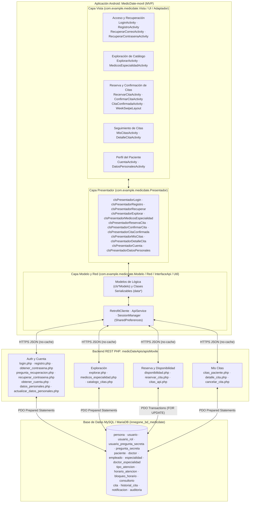

# Documentación Técnica General: Plataforma Móvil Android (`MedicDate-movil` y `apisMovile`)

## 1. Descripción General de la Plataforma

**MedicDate Móvil** es la aplicación nativa Android (escrita en **Kotlin** bajo arquitectura **MVP**) orientada a los **pacientes** del **Centro Médico Sagrado Corazón**. Permite a los usuarios crear su cuenta, iniciar sesión, recuperar su contraseña mediante pregunta secreta, explorar especialidades y médicos, consultar disponibilidad en tiempo real respetando días laborales y bloqueos de horario, reservar citas médicas de forma atómica, consultar sus citas próximas e históricas, cancelar citas con anticipación y administrar sus datos personales.

---

## 2. Arquitectura General de la Aplicación Móvil (MVP)

Toda la aplicación móvil sigue el patrón **Model-View-Presenter (MVP)** consumiendo servicios RESTful en PHP (`apisMovile`) mediante **Retrofit 2**, **OkHttp 4** (con interceptor `no-cache`) y **Kotlinx Serialization**, conectados a la base de datos relacional **MySQL/MariaDB en 3FN** (`innegone_bd_medicdate`).



---

## 3. Estructura del Proyecto Móvil (`MedicDate-movil`)

```text
MedicDate-movil/app/src/main/
├── AndroidManifest.xml
├── java/com/example/medicdate/
│   ├── Adaptador/
│   │   ├── CitasAdaptador.kt                   # Adaptador RecyclerView para lista de citas del paciente
│   │   ├── EspecialidadAdapter.kt              # Adaptador para cuadrícula de especialidades en Explorar
│   │   ├── MedicoEspecialidadAdapter.kt        # Adaptador de médicos filtrados por especialidad
│   │   └── MedicoExplorarAdapter.kt            # Adaptador de médicos destacados en Explorar
│   ├── InterfaceApi/
│   │   └── ApiService.kt                       # Definición de endpoints Retrofit (GET / POST)
│   ├── Modelo/
│   │   ├── clsLoginModelo.kt / dataLogin.kt
│   │   ├── clsRegistroModelo.kt / dataRegistro.kt / dataPregunta.kt
│   │   ├── clsRecuperarModelo.kt / dataRecuperar.kt
│   │   ├── clsExplorarModelo.kt / dataExplorar.kt
│   │   ├── clsMedicosEspecialidadModelo.kt / dataMedicosEspecialidad.kt
│   │   ├── clsDisponibilidadModelo.kt / dataDisponibilidad.kt / Horario.kt
│   │   ├── clsReservaCitaModelo.kt / dataReserva.kt
│   │   ├── clsMisCitasModelo.kt / dataCitaPaciente.kt
│   │   ├── clsDetalleCitaModelo.kt / dataDetalleCita.kt / dataCancelarCita.kt
│   │   ├── clsCuentaModelo.kt / dataCuenta.kt
│   │   └── clsDatosPersonalesModelo.kt / dataDatosPersonales.kt
│   ├── Presentador/
│   │   ├── clsPresentadorLogin.kt
│   │   ├── clsPresentadorRegistro.kt
│   │   ├── clsPresentadorRecuperar.kt
│   │   ├── clsPresentadorExplorar.kt
│   │   ├── clsPresentadorMedicosEspecialidad.kt
│   │   ├── clsPresentadorReservaCita.kt
│   │   ├── clsPresentadorConfirmarCita.kt
│   │   ├── clsPresentadorCitaConfirmada.kt
│   │   ├── clsPresentadorMisCitas.kt
│   │   ├── clsPresentadorDetalleCita.kt
│   │   ├── clsPresentadorCuenta.kt
│   │   └── clsPresentadorDatosPersonales.kt
│   ├── Red/
│   │   └── RetrofitCliente.kt                  # Cliente Retrofit + OkHttp NoCacheInterceptor + Json
│   ├── UI/
│   │   └── WeekSwipeLayout.kt                  # Selector semanal interactivo con filtro de días laborales
│   ├── Util/
│   │   └── SessionManager.kt                   # Persistencia de usuarioId, pacienteId y token
│   └── Vista/
│       ├── LoginActivity.kt                    # Pantalla 1: Inicio de sesión (LAUNCHER)
│       ├── RegistroActivity.kt                 # Pantalla 2: Crear cuenta de paciente
│       ├── RecuperarCorreoActivity.kt          # Recuperación paso 1: Validación de correo
│       ├── RecuperarContrasenaActivity.kt      # Recuperación paso 2: Pregunta secreta y nueva clave
│       ├── ExplorarActivity.kt                 # Pantalla 3: Inicio/Explorar (próxima cita, especialidades, médicos)
│       ├── MedicosEspecialidadActivity.kt      # Médicos por especialidad seleccionada
│       ├── RecervarCitaActivity.kt             # Pantalla 4: Selección de médico, tipo de atención, fecha y horario
│       ├── ConfirmarCitaActivity.kt            # Pantalla 5: Resumen pre-reserva y alerta de solapamiento
│       ├── CitaConfirmadaActivity.kt           # Pantalla 6: Ticket de cita confirmada
│       ├── MisCitasActivity.kt                 # Pantalla 7: Mis citas (Próximas e Historial)
│       ├── DetalleCitaActivity.kt              # Pantalla 8: Detalle de cita y cancelación (>= 24 h)
│       ├── CuentaActivity.kt                   # Pantalla 10: Menú de cuenta y cierre de sesión
│       └── DatosPersonalesActivity.kt          # Edición de datos personales del paciente
└── res/
    ├── drawable/                               # Fondos, tarjetas, badges y estados seleccionables
    ├── layout/                                 # Layouts XML de todas las pantallas e ítems
    └── values/                                 # colors.xml, strings.xml, themes.xml
```

---

## 4. Descripción de todos los Módulos de la Plataforma Móvil

### 4.1 Módulo de Autenticación, Registro y Recuperación de Contraseña
- **Inicio de Sesión (`LoginActivity.kt` + `login.php`)**:
  - Verifica credenciales contra cuentas con rol `paciente` y estado `activa` usando `password_verify`.
  - Registra `ultimo_acceso = NOW()`, guarda `usuarioId` y `pacienteId` en `SessionManager` y abre `ExplorarActivity`.
- **Registro de Paciente (`RegistroActivity.kt` + `registro.php`)**:
  - Captura nombres, apellidos, correo, teléfono, contraseña (`>= 8` caracteres), pregunta secreta (`obtener_contrasena.php`) y respuesta secreta.
  - En una transacción PDO vincula o inserta en `persona`, crea `usuario` con hash Bcrypt, asigna rol `paciente` en `usuario_rol`, guarda la respuesta secreta en `usuario_pregunta_secreta` y crea el perfil en `paciente`.
- **Recuperación de Contraseña (`RecuperarCorreoActivity.kt` + `RecuperarContrasenaActivity.kt`)**:
  - Consulta la pregunta secreta asociada al correo (`pregunta_recuperacion.php`) y permite restablecer la contraseña validando la respuesta secreta (`recuperar_contrasena.php`).

### 4.2 Módulo de Exploración y Catálogo de Especialistas
- **Explorar (`ExplorarActivity.kt` + `explorar.php`)**:
  - Muestra el saludo personalizado al paciente, la tarjeta de su **Próxima cita** activa (`inicio >= NOW()`), buscador en tiempo real, cuadrícula de especialidades activas y lista de médicos activos.
- **Médicos por Especialidad (`MedicosEspecialidadActivity.kt` + `medicos_especialidad.php`)**:
  - Filtra los médicos activos de una especialidad y calcula su `proximo_horario` disponible en los siguientes 30 días verificando `horario_atencion`, `cita` y `bloqueo_horario`.
  - Al seleccionar un médico, abre `RecervarCitaActivity` enviando `doctorId`, `doctorName`, `doctorSpecialty` y `tipoAtencionId`.

### 4.3 Módulo de Reserva y Confirmación de Citas
- **Selección de Fecha y Horario (`RecervarCitaActivity.kt` + `WeekSwipeLayout.kt` + `disponibilidad.php`)**:
  - Permite elegir el tipo de atención (*Primera consulta · 30 min* o *Seguimiento · 20 min*), navegar por semanas mediante botones o gesto *swipe*, y visualizar los horarios en bloques de 30 minutos.
  - Bloquea fechas pasadas/actual (`fecha <= CURDATE()`) y deshabilita automáticamente los días de la semana en los que el médico no atiende según `dias_atencion`, reubicando el calendario al primer día hábil futuro disponible.
  - Muestra deshabilitados y tachados los horarios ocupados por otras citas o bloqueados en `bloqueo_horario` (parciales, de día completo o multidía).
- **Confirmación y Detección de Solapamiento (`ConfirmarCitaActivity.kt` + `reservar_cita.php` + `citas_api.php`)**:
  - Presenta el resumen completo (médico, especialidad, tipo de atención, fecha/hora y consultorio).
  - Ejecuta la reserva en una transacción PDO con bloqueo pesimista (`FOR UPDATE`) verificando conflictos de médico, paciente, consultorio y `bloqueo_horario`.
  - Si otro usuario gana el horario o existe un bloqueo (`HTTP 409`), despliega el banner de conflicto `conflict_message` y el botón **"Elegir otro horario"**.
- **Cita Confirmada (`CitaConfirmadaActivity.kt`)**:
  - Muestra el comprobante de confirmação con especialidad, médico, fecha/hora, consultorio y número de cita (`#id_cita`).

### 4.4 Módulo de Seguimiento de Citas (Mis Citas, Detalle y Cancelación)
- **Mis Citas (`MisCitasActivity.kt` + `citas_paciente.php`)**:
  - Clasifica las citas del usuario en dos pestañas: **Próximas** (`pendiente` o `confirmada` con fecha/hora futura) e **Historial** (atendidas, canceladas o pasadas).
- **Detalle y Cancelación (`DetalleCitaActivity.kt` + `detalle_cita.php` + `cancelar_cita.php`)**:
  - Muestra estado, fecha, horario, médico, tipo de atención y consultorio.
  - Habilita la cancelación únicamente cuando resta al menos un día de anticipación, actualizando `estado = 'cancelada'`, `fecha_cancelacion = NOW()` e insertando trazabilidad en `historial_cita`.

### 4.5 Módulo de Cuenta y Datos Personales
- **Cuenta (`CuentaActivity.kt` + `obtener_cuenta.php`)**:
  - Muestra el nombre completo y correo del paciente, acceso a edición de perfil y cierre de sesión.
- **Datos Personales (`DatosPersonalesActivity.kt` + `datos_personales.php` + `actualizar_datos_personales.php`)**:
  - Permite consultar y actualizar nombres, apellido paterno, apellido materno y teléfono principal en la tabla `persona`.

---

## 5. Catálogo de Endpoints REST Móviles (`apisMovile`)

URL base configurada en [`RetrofitCliente.kt`](file:///C:/Users/PC/OneDrive/Desktop/MedicDate-movil/app/src/main/java/com/example/medicdate/Red/RetrofitCliente.kt):
```text
https://medicdate.innego.net/web/apis/movile/medicdate_api/
```

| Endpoint | Método | Parámetros / Body | Función Principal |
| :--- | :---: | :--- | :--- |
| `login.php` | `POST` | JSON: `correo`, `clave` | Autenticación de pacientes activos (`rol = 'paciente'`). |
| `registro.php` | `POST` | Form: `nombres`, `apellidoPaterno`, `apellidoMaterno`, `correo`, `telefono`, `clave`, `idPregunta`, `respuesta` | Registro transaccional de persona, usuario, rol, pregunta secreta y paciente. |
| `obtener_contrasena.php` | `GET` | — | Catálogo de preguntas secretas activas (`pregunta_secreta`). |
| `pregunta_recuperacion.php` | `POST` | JSON: `correo` | Obtiene la pregunta secreta registrada por el usuario. |
| `recuperar_contrasena.php` | `POST` | JSON: `correo`, `respuesta`, `nuevaClave` | Verifica respuesta secreta y actualiza `password_hash`. |
| `explorar.php` | `GET` | `idPaciente` | Saludo, próxima cita activa, especialidades y médicos activos. |
| `medicos_especialidad.php` | `GET` | `idEspecialidad` | Médicos de la especialidad con horarios y cálculo de `proximo_horario`. |
| `disponibilidad.php` | `GET` / `POST` | `datos` JSON: `id_empleado`, `id_tipo_atencion`, `fecha`, `id_usuario` | Retorna `dias_atencion` y slots de 30 min validando `cita` y `bloqueo_horario`. |
| `reservar_cita.php` | `POST` | JSON: `id_usuario`, `id_empleado`, `id_tipo_atencion`, `inicio`, `id_consultorio` | Reserva transaccional `FOR UPDATE`, inserta en `cita`, `historial_cita`, `notificacion` y `auditoria`. |
| `citas_paciente.php` | `GET` | `id_usuario` | Lista citas del paciente clasificadas en `proxima` e `historial`. |
| `detalle_cita.php` | `GET` | `id_cita`, `id_usuario` | Detalle completo de una cita propia del paciente. |
| `cancelar_cita.php` | `POST` | Form: `id_cita`, `id_usuario` | Cancela cita con validación de anticipación mínima. |
| `obtener_cuenta.php` | `GET` | `idUsuario` | Resumen de perfil para la pantalla Cuenta. |
| `datos_personales.php` | `GET` | `idUsuario`, `t` | Datos personales actuales de `persona`. |
| `actualizar_datos_personales.php` | `POST` | JSON: `idUsuario`, `nombres`, `apellidoPaterno`, `apellidoMaterno`, `telefono` | Actualiza datos de contacto del paciente en `persona`. |
