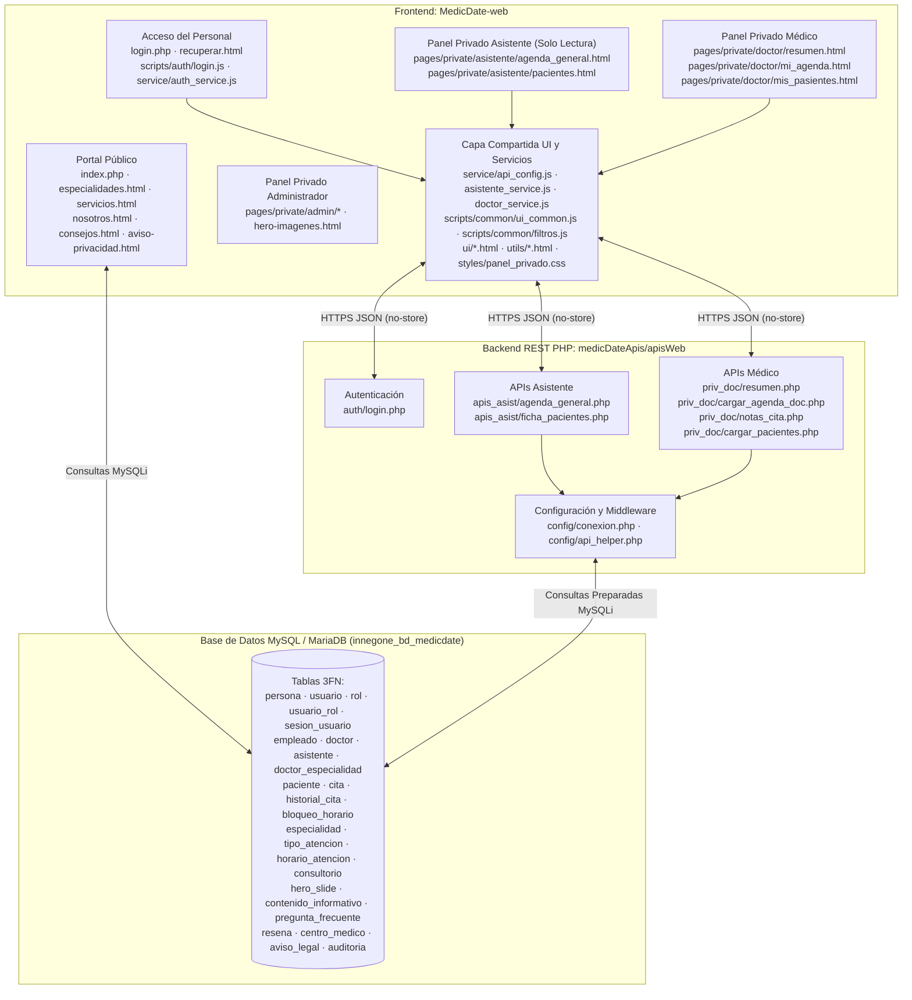

# Documentación Técnica General: Plataforma Web (`MedicDate-web` y `apisWeb`)

## 1. Descripción General de la Plataforma

**MedicDate Web** es la plataforma institucional y administrativa del **Centro Médico Sagrado Corazón**. Integra en una sola solución:
1. **Portal Público Institucional**: Presentación del centro médico, carrusel dinámico (*Hero*), catálogo de especialidades, servicios médicos, directorio de médicos, preguntas frecuentes, reseñas, consejos/noticias de salud y aviso de privacidad.
2. **Sistema de Autenticación y Recuperación del Personal**: Inicio de sesión por rol (`administrador`, `asistente`, `medico`) y flujo de recuperación de contraseña.
3. **Paneles Privados por Rol**:
   - **Panel Administrador**: Gestión de slides del carrusel hero, contenidos informativos, especialidades, servicios y configuración institucional.
   - **Panel Privado del Asistente (Solo Lectura)**: Agenda general multi-médico con KPIs en tiempo real y directorio/ficha de pacientes sin exposición de notas clínicas internas.
   - **Panel Privado del Médico**: Resumen ejecutivo (KPIs, siguiente cita, gráfica de 7 días, agenda de hoy), gestión de agenda propia con captura de notas clínicas internas y marcado de citas atendidas, e historial clínico por paciente.

---

## 2. Arquitectura General de la Plataforma Web

La plataforma implementa una **arquitectura cliente-servidor desacoplada por capas** con comunicación RESTful JSON sin caché (`Cache-Control: no-store`) sobre MySQL/MariaDB normalizada en **3FN** (`innegone_bd_medicdate`).



---

## 3. Estructura de Directorios del Proyecto Web

### 3.1 Frontend (`MedicDate-web`)

```text
MedicDate-web/
├── index.php                                   # Portal público principal conectado a hero_slide
├── especialidades.html                         # Catálogo público de especialidades médicas
├── servicios.html                              # Catálogo público de tipos de atención y costos
├── nosotros.html                               # Información institucional, misión, visión y ubicación
├── consejos.html                               # Artículos, avisos y noticias de salud
├── consejo.html                                # Vista detalle de artículo o consejo médico
├── aviso-privacidad.html                       # Aviso legal y derechos ARCO
├── login.php                                   # Inicio de sesión del personal (Administrador, Asistente, Médico)
├── recuperar.html                              # Recuperación de contraseña del personal
├── hero-imagenes.html                          # Administración de diapositivas del carrusel principal
│
├── includes/
│   ├── head.php                                # Metadatos, Bootstrap 5.3 y hojas de estilo públicas
│   └── header.php                              # Barra de navegación pública institucional
│
├── css/
│   └── estilos.css                             # Estilos del portal público y pantalla de acceso
├── styles/
│   └── panel_privado.css                       # Sistema de diseño Material Design 3 para paneles privados
│
├── ui/
│   ├── lateral_panel_asistente.html            # Menú lateral del perfil Asistente
│   └── lateral_panel_doctor.html               # Menú lateral del perfil Médico
│
├── utils/
│   ├── ventana_descripcion_cita.html           # Modal reutilizable para ver detalle o atender cita
│   ├── ventana_historial_paciente.html         # Modal reutilizable para ficha e historial de paciente
│   └── filtros/                                # Utilidades de filtrado por paciente, estado y lapso
│
├── service/
│   ├── api_config.js                           # Cliente HTTP fetch (no-store), gestión de sesión y errores
│   ├── auth_service.js                         # Consumo de auth/login.php
│   ├── asistente_service.js                    # Consumo de endpoints del perfil Asistente
│   └── doctor_service.js                       # Consumo de endpoints del perfil Médico
│
├── scripts/
│   ├── auth/
│   │   └── login.js                            # Controlador de inicio de sesión y redirección por rol
│   ├── common/
│   │   ├── ui_common.js                        # Layout privado, carga de fragmentos, modales, badges y manejo de errores API
│   │   └── filtros.js                          # Búsqueda normalizada sin acentos y filtros en cliente
│   ├── asistente/
│   │   ├── agenda.js                           # Controlador de Agenda general del asistente
│   │   └── pacientes.js                        # Controlador de Pacientes del asistente
│   └── doctor/
│       ├── resumen.js                          # Controlador de Resumen del médico
│       ├── agenda.js                           # Controlador de Mi agenda del médico
│       └── pacientes.js                        # Controlador de Mis pacientes del médico
│
└── pages/
    └── private/
        ├── admin/                              # Vistas privadas del Administrador
        ├── asistente/
        │   ├── agenda_general.html             # Vista privada: Agenda general (/asistente/agenda)
        │   └── pacientes.html                  # Vista privada: Pacientes (/asistente/pacientes)
        └── doctor/
            ├── resumen.html                    # Vista privada: Resumen del médico (/doctor/inicio)
            ├── mi_agenda.html                  # Vista privada: Mi agenda (/doctor/agenda)
            └── mis_pasientes.html              # Vista privada: Mis pacientes (/doctor/pacientes)
```

### 3.2 Backend REST (`medicDateApis/apisWeb`)

```text
medicDateApis/apisWeb/
├── config/
│   ├── conexion.php                            # Conexión MySQLi (UTF-8 mb4) con manejo de excepciones
│   └── api_helper.php                          # CORS, encabezados no-cache, validación de sesión/rol y auditoría
├── apis_asist/
│   ├── agenda_general.php                      # GET: KPIs, listado filtrable de citas y detalle sin notas internas
│   └── ficha_pacientes.php                     # GET: Directorio de pacientes y ficha con citas (solo lectura)
└── priv_doc/
    ├── resumen.php                             # GET: Perfil, horario, KPIs, siguiente cita, gráfica 7 días y agenda hoy
    ├── cargar_agenda_doc.php                   # GET: Agenda del médico por lapso/estado y detalle con notas e historial
    ├── notas_cita.php                          # POST: Transacción atómica para guardar notas y marcar cita atendida
    └── cargar_pacientes.php                    # GET/POST: Pacientes propios del médico, historial clínico y alergias
```

---

## 4. Descripción de todos los Módulos de la Plataforma Web

### 4.1 Módulo de Portal Público (`index.php`, `especialidades.html`, `servicios.html`, `nosotros.html`, `consejos.html`)
- **Carrusel Hero (`index.php`)**: Consulta en tiempo real la tabla `hero_slide` (`WHERE activo = 1 ORDER BY orden ASC`) para renderizar diapositivas con título, descripción, color de fondo, imagen y botón de acción.
- **Catálogo Institucional**: Presenta las especialidades activas (`especialidad`), tipos de atención (`tipo_atencion`), información del centro médico (`centro_medico`), preguntas frecuentes (`pregunta_frecuente`), reseñas (`resena`) y aviso de privacidad (`aviso_legal`).

### 4.2 Módulo de Autenticación del Personal (`login.php`, `scripts/auth/login.js`, `service/auth_service.js`)
- Valida correo y contraseña contra `auth/login.php`.
- Almacena y normaliza la sesión en `sessionStorage` mediante `MedicDateApi.guardarSesion()` (incluyendo normalización de rol sin acentos y respaldo desde `roles[]`).
- Redirige automáticamente según el rol autenticado:
  - `administrador` -> `pages/private/admin/panel.html`
  - `asistente` -> `pages/private/asistente/agenda_general.html`
  - `medico` -> `pages/private/doctor/resumen.html`

### 4.3 Módulo de Panel Privado del Asistente (`pages/private/asistente/`)
Opera bajo una política estricta de **solo lectura (`GET`)** y confidencialidad médica:
1. **Agenda General (`agenda_general.html` + `scripts/asistente/agenda.js`)**:
   - Muestra 4 indicadores superiores: *Citas de hoy*, *Programadas*, *Pacientes* y *Médicos*.
   - Permite filtrar simultáneamente por *Día* (`YYYY-MM-DD`), *Médico* y *Estado* (`Programada`, `Atendida`, `Cancelada`).
   - El modal de detalle (`ventana_descripcion_cita.html`) muestra fecha, hora, paciente, teléfono, médico, especialidad, motivo y estado, **excluyendo `notas_internas` del médico**.
2. **Directorio de Pacientes (`pacientes.html` + `scripts/asistente/pacientes.js`)**:
   - Lista los pacientes activos con buscador instantáneo en cliente por nombre, correo o teléfono.
   - El modal de ficha (`ventana_historial_paciente.html`) muestra datos de contacto, edad calculada desde `fecha_nacimiento` y el listado de citas registradas.

### 4.4 Módulo de Panel Privado del Médico (`pages/private/doctor/`)
Filtra todas las consultas en el servidor por el `id_empleado` del médico autenticado:
1. **Resumen del Médico (`resumen.html` + `scripts/doctor/resumen.js`)**:
   - Encabezado con nombre del médico, especialidades y días/horarios de atención activos en `horario_atencion`.
   - 5 tarjetas KPI: *Citas hoy*, *Por atender hoy*, *Atendidas hoy*, *Próximos 7 días* y *Pacientes*.
   - Tarjeta destacada *Siguiente por atender* con acceso directo al modal clínico.
   - Gráfica de barras de carga de citas para los próximos 7 días.
   - Tabla *Agenda de hoy* con apertura directa del modal de atención.
2. **Mi Agenda (`mi_agenda.html` + `scripts/doctor/agenda.js`)**:
   - Conmutador por lapso (*Hoy*, *Próximos 7 días*, *Todas*) con cambio automático a *Próximos 7 días* en la carga inicial si hoy no tiene citas, más filtro por *Estado*.
   - Modal clínico (`ventana_descripcion_cita.html`) para capturar/guardar `notas_internas` y botón **Marcar como atendida** (habilitado cuando la cita está programada y `DATE(inicio) <= CURDATE()`).
3. **Mis Pacientes (`mis_pasientes.html` + `scripts/doctor/pacientes.js`)**:
   - Tabla de pacientes atendidos o agendados con el médico (*Edad*, *Citas*, *Última consulta*, *Próxima cita*).
   - Modal *Historial contigo* (`ventana_historial_paciente.html`) con edad, teléfono, correo, alergias y línea de tiempo de consultas con sus `notas_internas`.

---

## 5. Catálogo de Endpoints REST (`apisWeb`)

URL base configurada en [`service/api_config.js`](file:///C:/Users/PC/OneDrive/Desktop/MedicDate-web/service/api_config.js):
```text
https://medicdate.innego.net/web/apis/medicdate
```

| Endpoint | Método | Roles Permitidos | Parámetros Principales | Descripción |
| :--- | :---: | :---: | :--- | :--- |
| `auth/login.php` | `POST` | Personal | `correo`, `clave` | Autentica personal y devuelve perfil, rol y datos de sesión. |
| `apis_asist/agenda_general.php` | `GET` | `asistente`, `administrador` | `id_usuario`, `fecha`, `id_medico`, `estado`, `id_cita` | KPIs generales, catálogo de médicos, citas filtradas o detalle de cita sin `notas_internas`. |
| `apis_asist/ficha_pacientes.php` | `GET` | `asistente`, `administrador` | `id_usuario`, `busqueda`, `id_paciente` | Directorio de pacientes activos o ficha individual con sus citas (solo lectura). |
| `priv_doc/resumen.php` | `GET` | `medico` | `id_usuario` / `token` / `id_sesion` | Perfil y horario del médico, 5 KPIs, siguiente cita, gráfica de 7 días y agenda de hoy. |
| `priv_doc/cargar_agenda_doc.php` | `GET` | `medico` | `id_usuario`, `lapso`, `fecha`, `estado`, `id_cita` | Agenda propia del médico filtrada o detalle de cita con `notas_internas` e `historial_cita`. |
| `priv_doc/notas_cita.php` | `POST` | `medico` | `id_usuario`, `id_cita`, `notas_internas`, `marcar_atendida` | Transacción `FOR UPDATE` que guarda notas, actualiza estado a `completada` y registra en `historial_cita` y `auditoria`. |
| `priv_doc/cargar_pacientes.php` | `GET` / `POST` | `medico` | `id_usuario`, `busqueda`, `id_paciente`, `alergias`, `notas_medicas` | Pacientes del médico, historial clínico completo con notas por cita y actualización de expediente básico. |

---

## 6. Mapeo de Estados y Seguridad

| Estado en BD (`cita.estado`) | Etiqueta Visual en Web | Clase CSS | Regla de Negocio |
| :--- | :---: | :---: | :--- |
| `pendiente`, `confirmada`, `en_progreso` | **Programada** | `.badge.b-azul` | Editable en notas por el médico; atendible cuando `DATE(inicio) <= CURDATE()`. |
| `completada` | **Atendida** | `.badge.b-ok` | Notas editables por el médico; contabilizada en métricas de consultas atendidas. |
| `cancelada`, `inasistencia` | **Cancelada** | `.badge.b-rojo` | Bloqueada para edición de notas y para marcado como atendida. |
