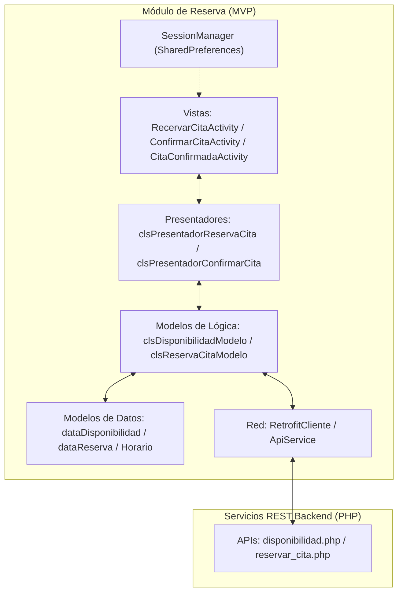
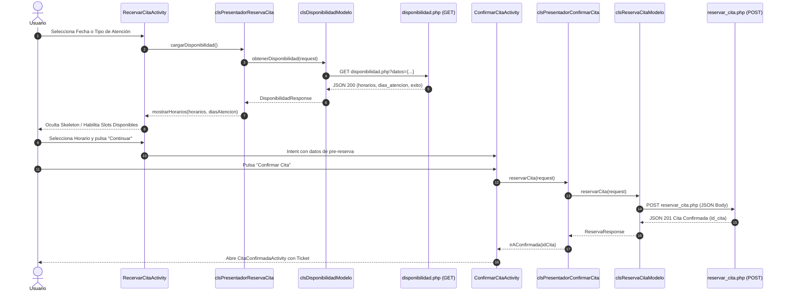

# Documentación Técnica: Módulo de Reserva y Confirmación de Citas

## 1. Resumen del Módulo

El **Módulo de Reserva y Confirmación de Citas** es el componente central de interacción de la aplicación móvil **MedicDate**. Su objetivo es permitir a los pacientes consultar la disponibilidad de horarios de un doctor en tiempo real, filtrar por días de atención y tipo de servicio, seleccionar una franja horaria válida y confirmar la reserva de manera atómica con el backend.

---

## 2. Arquitectura del Módulo (MVP)

El módulo sigue la arquitectura **Model-View-Presenter (MVP)**, garantizando la separación entre la interfaz gráfica, la lógica de presentación y el consumo de datos de red.



---

## 3. Componentes del Módulo

### 3.1 Vistas y Pantallas (`com.example.medicdate.Vista`)

#### 1. [`RecervarCitaActivity.kt`](file:///C:/Users/PC/OneDrive/Desktop/MedicDate-movil/app/src/main/java/com/example/medicdate/Vista/RecervarCitaActivity.kt)
- **Responsabilidad**: Interfaz gráfica para la selección de fecha y hora.
- **Elementos UI**:
  - Encabezado dinámico con iniciales, nombre y especialidad del doctor.
  - Conmutador de tipo de atención (*Primera consulta - 30 min* / *Seguimiento - 20 min*) con actualización dinámica de bordes (`bg_option_selected` / `bg_option_default`).
  - Navegador semanal interactivo (`WeekSwipeLayout`) con botones anterior/siguiente y gestos táctiles (*swipe*).
  - Cargador esqueleto animado (*Skeleton Shadow Load*) que se pulsa mientras se consulta la API.
  - Cuadrícula independiente de horarios (`rvHorarios` con `GridLayoutManager`) con scroll aislado.
  - Barra de resumen inferior con botón de acción **"Continuar"**.

#### 2. [`ConfirmarCitaActivity.kt`](file:///C:/Users/PC/OneDrive/Desktop/MedicDate-movil/app/src/main/java/com/example/medicdate/Vista/ConfirmarCitaActivity.kt)
- **Responsabilidad**: Resumen pre-reserva de la cita.
- **Funcionalidad**: Valida la sesión activa del usuario vía `SessionManager`. Muestra el desglose del doctor, tipo de atención, fecha/hora formateada (*ej. "Lunes 23 de noviembre de 2026 · 16:30"*) y consultorio. Al presionar **"Confirmar cita"**, invoca la transacción final.

#### 3. [`CitaConfirmadaActivity.kt`](file:///C:/Users/PC/OneDrive/Desktop/MedicDate-movil/app/src/main/java/com/example/medicdate/Vista/CitaConfirmadaActivity.kt)
- **Responsabilidad**: Pantalla de éxito post-reserva.
- **Funcionalidad**: Despliega la confirmación con el número de ticket (`#id_cita`), fecha/hora y botones de retorno a las actividades del sistema.

#### 4. Componente UI Personalizado: [`WeekSwipeLayout.kt`](file:///C:/Users/PC/OneDrive/Desktop/MedicDate-movil/app/src/main/java/com/example/medicdate/UI/WeekSwipeLayout.kt)
- **Filtro por Días de Atención**: Deshabilita (`alpha = 0.35f`, `isEnabled = false`) los días en los que el médico no tiene registrada agenda.
- **Filtro de Fechas Pasadas**: Bloquea cualquier selección de fecha menor o igual a hoy (`fecha <= CURDATE()`).
- **Enfoque Automático**: Selecciona y sincroniza el calendario al primer día hábil futuro disponible.

---

### 3.2 Presentadores (`com.example.medicdate.Presentador`)

| Presentador | Métodos Clave | Descripción |
| :--- | :--- | :--- |
| [`clsPresentadorReservaCita.kt`](file:///C:/Users/PC/OneDrive/Desktop/MedicDate-movil/app/src/main/java/com/example/medicdate/Presentador/clsPresentadorReservaCita.kt) | `cargarDisponibilidad(idEmpleado, idTipoAtencion, fecha, idUsuario)` | Ejecuta la consulta de disponibilidad en una Coroutine (`Dispatchers.Main`) y notifica a la vista (`mostrarHorarios` o `mostrarError`). |
| [`clsPresentadorConfirmarCita.kt`](file:///C:/Users/PC/OneDrive/Desktop/MedicDate-movil/app/src/main/java/com/example/medicdate/Presentador/clsPresentadorConfirmarCita.kt) | `reservarCita(request)` | Procesa la petición de reserva final. Al recibir confirmación exitosa (`exito = true`), invoca `vista.irAConfirmada(idCita)`. |
| [`clsPresentadorCitaConfirmada.kt`](file:///C:/Users/PC/OneDrive/Desktop/MedicDate-movil/app/src/main/java/com/example/medicdate/Presentador/clsPresentadorCitaConfirmada.kt) | `mostrarCita(idCita)` | Gestiona el renderizado de los detalles del ticket de confirmación. |

---

### 3.3 Modelos de Lógica y Clases de Datos (`com.example.medicdate.Modelo`)

#### Clases de Lógica de Negocio:
- [`clsDisponibilidadModelo.kt`](file:///C:/Users/PC/OneDrive/Desktop/MedicDate-movil/app/src/main/java/com/example/medicdate/Modelo/clsDisponibilidadModelo.kt): Realiza la petición a la API `disponibilidad.php`. Captura respuestas de error HTTP (422, 409, 400) y extrae el JSON descriptivo enviado por el backend.
- [`clsReservaCitaModelo.kt`](file:///C:/Users/PC/OneDrive/Desktop/MedicDate-movil/app/src/main/java/com/example/medicdate/Modelo/clsReservaCitaModelo.kt): Ejecuta la petición `POST` hacia `reservar_cita.php`.

#### Archivos de Datos Serializables:
- [`dataDisponibilidad.kt`](file:///C:/Users/PC/OneDrive/Desktop/MedicDate-movil/app/src/main/java/com/example/medicdate/Modelo/dataDisponibilidad.kt):
  - `DisponibilidadRequest`: Encapsula `id_empleado`, `id_tipo_atencion`, `fecha` e `id_usuario`.
  - `DisponibilidadResponse`: Retorna `exito`, `mensaje`, `medico`, `tipo_atencion`, `duracion_minutos`, `dias_atencion` y la lista de `horarios`.
- [`dataReserva.kt`](file:///C:/Users/PC/OneDrive/Desktop/MedicDate-movil/app/src/main/java/com/example/medicdate/Modelo/dataReserva.kt):
  - `ReservaRequest`: Encapsula `id_usuario`, `id_empleado`, `id_tipo_atencion`, `inicio` e `id_consultorio`.
  - `ReservaResponse`: Retorna `exito`, `codigo`, `mensaje`, `id_cita` y el objeto `cita`.
  - `CitaDetalleReserva`: Estructura detallada del ticket de cita.
- [`Horario.kt`](file:///C:/Users/PC/OneDrive/Desktop/MedicDate-movil/app/src/main/java/com/example/medicdate/Modelo/Horario.kt):
  - `Horario`: Representa un slot individual con `inicio`, `fin`, `hora`, `consultorio` y el indicador booleano `disponible`.

---

## 4. Consumo de APIs REST (Backend PHP)

### 4.1 Endpoints Consumidos por el Módulo



---

### 4.2 Detalle de Endpoints PHP

#### 1. `disponibilidad.php`
- **Método**: `GET` (vía parámetro query `datos` en JSON) / `POST`.
- **Estructura Query `datos`**:
  ```json
  {
    "id_empleado": 2,
    "id_tipo_atencion": 1,
    "fecha": "2026-11-23",
    "id_usuario": 5
  }
  ```
- **Respuesta JSON**:
  ```json
  {
    "exito": true,
    "mensaje": "Selecciona un horario disponible.",
    "fecha": "2026-11-23",
    "medico": "Jose Manuel Rodriguez Lopez",
    "tipo_atencion": "Consulta de Medicina General",
    "duracion_minutos": 30,
    "dias_atencion": [1, 2, 3, 4, 5],
    "horarios": [
      {
        "inicio": "2026-11-23 09:00:00",
        "fin": "2026-11-23 09:30:00",
        "hora": "09:00",
        "duracion_minutos": 30,
        "disponible": false
      },
      {
        "inicio": "2026-11-23 11:00:00",
        "fin": "2026-11-23 11:30:00",
        "hora": "11:00",
        "duracion_minutos": 30,
        "disponible": true
      }
    ]
  }
  ```

#### 2. `reservar_cita.php`
- **Método**: `POST` (`application/json`).
- **Body JSON**:
  ```json
  {
    "id_usuario": 5,
    "id_empleado": 2,
    "id_tipo_atencion": 1,
    "inicio": "2026-11-23 11:00:00"
  }
  ```
- **Respuesta JSON (HTTP 201)**:
  ```json
  {
    "exito": true,
    "codigo": "CITA_CONFIRMADA",
    "mensaje": "Cita confirmada.",
    "cita": {
      "id_cita": 14,
      "estado": "confirmada",
      "fecha": "2026-11-23",
      "hora": "11:00",
      "duracion_minutos": 30,
      "medico": "Jose Manuel Rodriguez Lopez",
      "tipo_atencion": "Consulta de Medicina General",
      "consultorio": "Consultorio 101 - Medicina Familiar"
    }
  }
  ```

---

## 5. Decisiones de Diseño y Optimizaciones

1. **Prevención de Caché en Red**:
   En [`RetrofitCliente.kt`](file:///C:/Users/PC/OneDrive/Desktop/MedicDate-movil/app/src/main/java/com/example/medicdate/Red/RetrofitCliente.kt) se implementó un `OkHttpClient` con interceptor que añade los encabezados `Cache-Control: no-cache, no-store, must-revalidate` y `Pragma: no-cache`, obligando a consultar la disponibilidad en la BD en tiempo real.

2. **Intervalo Estándar de 30 Minutos**:
   Se estandarizó la generación interna de slots a bloques uniformes de **30 minutos** tanto en la API PHP como en la app Android. Esto evita desfasamientos en la cuadrícula de horarios.

3. **Cargador Esqueleto (Skeleton Shadow Load)**:
   Durante el tiempo de vuelo de la API de disponibilidad, la pantalla despliega un contenedor de esqueleto animado (`AlphaAnimation`) que se oculta únicamente al recibir la respuesta con los horarios.

4. **Persistencia de Sesión**:
   Uso de [`SessionManager.kt`](file:///C:/Users/PC/OneDrive/Desktop/MedicDate-movil/app/src/main/java/com/example/medicdate/Util/SessionManager.kt) con `SharedPreferences` para preservar `usuarioId` y `pacienteId`, garantizando que la reserva se procese con la cuenta autenticada.
