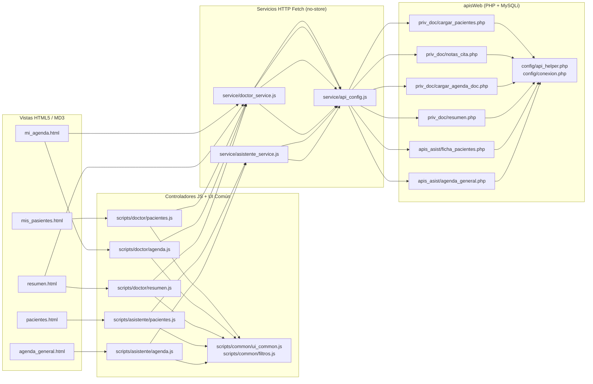

# Documentación Técnica: Módulos Privados de Asistente y Médico (Plataforma Web)

## 1. Resumen de los Módulos

Los **Módulos Privados de Asistente y Médico** conforman el núcleo operativo clínico y de recepción dentro de **MedicDate Web**. Están compuestos por **5 vistas privadas** conectadas en tiempo real (sin caché) a `apisWeb` y a la base de datos `innegone_bd_medicdate`:
- **Perfil Asistente (2 vistas, solo lectura)**:
  1. **Agenda general del asistente** (`/asistente/agenda` -> [`pages/private/asistente/agenda_general.html`](file:///C:/Users/PC/OneDrive/Desktop/MedicDate-web/pages/private/asistente/agenda_general.html))
  2. **Pacientes del asistente** (`/asistente/pacientes` -> [`pages/private/asistente/pacientes.html`](file:///C:/Users/PC/OneDrive/Desktop/MedicDate-web/pages/private/asistente/pacientes.html))
- **Perfil Médico (3 vistas, gestión clínica de agenda propia)**:
  3. **Resumen del médico** (`/doctor/inicio` -> [`pages/private/doctor/resumen.html`](file:///C:/Users/PC/OneDrive/Desktop/MedicDate-web/pages/private/doctor/resumen.html))
  4. **Mi agenda del médico** (`/doctor/agenda` -> [`pages/private/doctor/mi_agenda.html`](file:///C:/Users/PC/OneDrive/Desktop/MedicDate-web/pages/private/doctor/mi_agenda.html))
  5. **Mis pacientes del médico** (`/doctor/pacientes` -> [`pages/private/doctor/mis_pasientes.html`](file:///C:/Users/PC/OneDrive/Desktop/MedicDate-web/pages/private/doctor/mis_pasientes.html))

---

## 2. Arquitectura de los Módulos Privados Web

---

## 3. Detalle Técnico por Vista

### 3.1 Agenda General del Asistente (`agenda_general.html`)
- **Controlador**: [`scripts/asistente/agenda.js`](file:///C:/Users/PC/OneDrive/Desktop/MedicDate-web/scripts/asistente/agenda.js)
- **Servicio**: `AsistenteService.obtenerAgendaGeneral(filtros)` y `AsistenteService.obtenerDetalleCitaAsistente(idCita)`
- **Endpoint**: [`apisWeb/apis_asist/agenda_general.php`](file:///c:/Users/PC/OneDrive/Desktop/medicDateApis/apisWeb/apis_asist/agenda_general.php) (`GET`)
- **Funcionalidad**:
  - Renderiza 4 KPIs: `citas_hoy`, `programadas`, `pacientes` y `medicos`.
  - Carga dinámicamente el `<select id="filtroMedico">` con los doctores activos.
  - Filtra por fecha (`YYYY-MM-DD`), médico (`id_medico`) y estado (`Programada`, `Atendida`, `Cancelada`) con identificador incremental `solicitudAgendaId` para descartar respuestas obsoletas.
  - Al pulsar **Ver**, abre el modal [`utils/ventana_descripcion_cita.html`](file:///C:/Users/PC/OneDrive/Desktop/MedicDate-web/utils/ventana_descripcion_cita.html) en modo solo lectura ocultando la sección clínica del doctor (`#mcSeccionDoctor`).

### 3.2 Pacientes del Asistente (`pacientes.html`)
- **Controlador**: [`scripts/asistente/pacientes.js`](file:///C:/Users/PC/OneDrive/Desktop/MedicDate-web/scripts/asistente/pacientes.js)
- **Servicio**: `AsistenteService.obtenerPacientesAsistente(busqueda)` y `AsistenteService.obtenerFichaPacienteAsistente(idPaciente)`
- **Endpoint**: [`apisWeb/apis_asist/ficha_pacientes.php`](file:///c:/Users/PC/OneDrive/Desktop/medicDateApis/apisWeb/apis_asist/ficha_pacientes.php) (`GET`)
- **Funcionalidad**:
  - Lista los pacientes activos con nombre, correo, teléfono y edad calculada en el servidor (`calcularEdad()`).
  - Filtra instantáneamente en cliente mediante `MedicDateFiltros.buscarPaciente()`.
  - Al pulsar **Ver ficha**, abre [`utils/ventana_historial_paciente.html`](file:///C:/Users/PC/OneDrive/Desktop/MedicDate-web/utils/ventana_historial_paciente.html) mostrando datos de contacto y tabla de citas del paciente sin notas clínicas.

### 3.3 Resumen del Médico (`resumen.html`)
- **Controlador**: [`scripts/doctor/resumen.js`](file:///C:/Users/PC/OneDrive/Desktop/MedicDate-web/scripts/doctor/resumen.js)
- **Servicio**: `DoctorService.obtenerResumenMedico()`, `obtenerDetalleCitaMedico(idCita)` y `guardarNotasCita(idCita, notas, marcarAtendida)`
- **Endpoint**: [`apisWeb/priv_doc/resumen.php`](file:///c:/Users/PC/OneDrive/Desktop/medicDateApis/apisWeb/priv_doc/resumen.php) (`GET`)
- **Funcionalidad**:
  - Muestra el encabezado con el nombre del médico, especialidades concatenadas y días/horarios activos desde `horario_atencion`.
  - Renderiza 5 KPIs propios del médico (`citas_hoy`, `por_atender_hoy`, `atendidas_hoy`, `proximos_7_dias`, `pacientes`).
  - Muestra la tarjeta **Siguiente por atender**, la **Gráfica de barras de los próximos 7 días** y la tabla **Agenda de hoy**, permitiendo abrir el modal clínico para guardar notas o marcar la cita como atendida.

### 3.4 Mi Agenda del Médico (`mi_agenda.html`)
- **Controlador**: [`scripts/doctor/agenda.js`](file:///C:/Users/PC/OneDrive/Desktop/MedicDate-web/scripts/doctor/agenda.js)
- **Servicio**: `DoctorService.obtenerAgendaMedico(filtros)`, `obtenerDetalleCitaMedico(idCita)` y `guardarNotasCita(idCita, notas, marcarAtendida)`
- **Endpoints**: [`apisWeb/priv_doc/cargar_agenda_doc.php`](file:///c:/Users/PC/OneDrive/Desktop/medicDateApis/apisWeb/priv_doc/cargar_agenda_doc.php) (`GET`) y [`apisWeb/priv_doc/notas_cita.php`](file:///c:/Users/PC/OneDrive/Desktop/medicDateApis/apisWeb/priv_doc/notas_cita.php) (`POST`)
- **Funcionalidad**:
  - Filtros por lapso (`hoy`, `semana`, `todas`) y por estado (`Programada`, `Atendida`, `Cancelada`). Si en la primera carga no existen citas en `hoy`, cambia automáticamente a `semana` (*Próximos 7 días*).
  - En el modal de cita:
    - Habilita la captura y guardado de `notas_internas` siempre que la cita no esté cancelada.
    - Habilita el botón **Marcar como atendida** solo si la cita está programada y `DATE(inicio) <= CURDATE()`; si la cita es de una fecha futura, muestra el aviso `#mcAvisoFecha`.
    - Deshabilita los botones de acción durante el guardado para evitar envíos duplicados.

### 3.5 Mis Pacientes del Médico (`mis_pasientes.html`)
- **Controlador**: [`scripts/doctor/pacientes.js`](file:///C:/Users/PC/OneDrive/Desktop/MedicDate-web/scripts/doctor/pacientes.js)
- **Servicio**: `DoctorService.obtenerMisPacientes(busqueda)` y `obtenerHistorialPacienteMedico(idPaciente)`
- **Endpoint**: [`apisWeb/priv_doc/cargar_pacientes.php`](file:///c:/Users/PC/OneDrive/Desktop/medicDateApis/apisWeb/priv_doc/cargar_pacientes.php) (`GET` / `POST`)
- **Funcionalidad**:
  - Lista los pacientes que tienen citas registradas con el médico autenticado, mostrando *Edad*, *Citas*, *Última consulta* y *Próxima cita*.
  - Filtra en tiempo real por nombre, correo, teléfono o alergias con `MedicDateFiltros.buscarPacienteMedico()`.
  - Al pulsar **Ver historial**, abre el modal con datos de contacto, alergias y todas las consultas previas con el médico incluyendo sus `notas_internas`.
