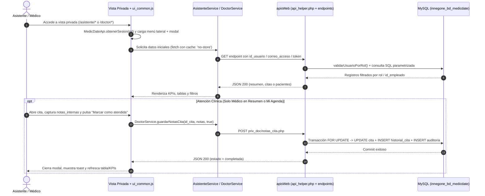
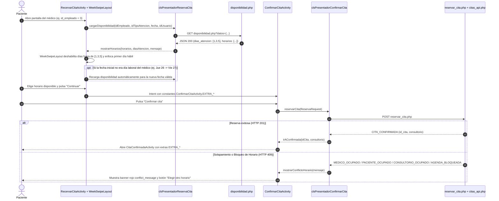

# Documentación Técnica de Módulos Asignados por Plataforma (Web y Móvil)

Este documento describe de forma detallada y exclusiva los módulos bajo tu responsabilidad en cada plataforma del ecosistema **MedicDate**, conectados a la base de datos `innegone_bd_medicdate`.

---

## Parte I — Plataforma Web: Paneles Privados de Asistente y Médico (`MedicDate-web` + `apisWeb`)

### 1. Alcance del Módulo Web Asignado (5 Vistas Privadas)

| # | Ruta / Vista | Perfil | Archivo HTML | Controlador JS | Endpoint Backend PHP |
| :-: | :--- | :---: | :--- | :--- | :--- |
| 1 | `/asistente/agenda` (Agenda general del asistente) | Asistente | [`pages/private/asistente/agenda_general.html`](file:///C:/Users/PC/OneDrive/Desktop/MedicDate-web/pages/private/asistente/agenda_general.html) | [`scripts/asistente/agenda.js`](file:///C:/Users/PC/OneDrive/Desktop/MedicDate-web/scripts/asistente/agenda.js) | [`apisWeb/apis_asist/agenda_general.php`](file:///c:/Users/PC/OneDrive/Desktop/medicDateApis/apisWeb/apis_asist/agenda_general.php) |
| 2 | `/asistente/pacientes` (Pacientes del asistente) | Asistente | [`pages/private/asistente/pacientes.html`](file:///C:/Users/PC/OneDrive/Desktop/MedicDate-web/pages/private/asistente/pacientes.html) | [`scripts/asistente/pacientes.js`](file:///C:/Users/PC/OneDrive/Desktop/MedicDate-web/scripts/asistente/pacientes.js) | [`apisWeb/apis_asist/ficha_pacientes.php`](file:///c:/Users/PC/OneDrive/Desktop/medicDateApis/apisWeb/apis_asist/ficha_pacientes.php) |
| 3 | `/doctor/inicio` (Resumen del médico) | Médico | [`pages/private/doctor/resumen.html`](file:///C:/Users/PC/OneDrive/Desktop/MedicDate-web/pages/private/doctor/resumen.html) | [`scripts/doctor/resumen.js`](file:///C:/Users/PC/OneDrive/Desktop/MedicDate-web/scripts/doctor/resumen.js) | [`apisWeb/priv_doc/resumen.php`](file:///c:/Users/PC/OneDrive/Desktop/medicDateApis/apisWeb/priv_doc/resumen.php) · [`notas_cita.php`](file:///c:/Users/PC/OneDrive/Desktop/medicDateApis/apisWeb/priv_doc/notas_cita.php) |
| 4 | `/doctor/agenda` (Mi agenda del médico) | Médico | [`pages/private/doctor/mi_agenda.html`](file:///C:/Users/PC/OneDrive/Desktop/MedicDate-web/pages/private/doctor/mi_agenda.html) | [`scripts/doctor/agenda.js`](file:///C:/Users/PC/OneDrive/Desktop/MedicDate-web/scripts/doctor/agenda.js) | [`apisWeb/priv_doc/cargar_agenda_doc.php`](file:///c:/Users/PC/OneDrive/Desktop/medicDateApis/apisWeb/priv_doc/cargar_agenda_doc.php) · [`notas_cita.php`](file:///c:/Users/PC/OneDrive/Desktop/medicDateApis/apisWeb/priv_doc/notas_cita.php) |
| 5 | `/doctor/pacientes` (Mis pacientes del médico) | Médico | [`pages/private/doctor/mis_pasientes.html`](file:///C:/Users/PC/OneDrive/Desktop/MedicDate-web/pages/private/doctor/mis_pasientes.html) | [`scripts/doctor/pacientes.js`](file:///C:/Users/PC/OneDrive/Desktop/MedicDate-web/scripts/doctor/pacientes.js) | [`apisWeb/priv_doc/cargar_pacientes.php`](file:///c:/Users/PC/OneDrive/Desktop/medicDateApis/apisWeb/priv_doc/cargar_pacientes.php) |

---

### 2. Arquitectura y Flujo de los Módulos Web Asignados

---

### 3. Componentes Compartidos de Carga y Seguridad en Web

1. **[`service/api_config.js`](file:///C:/Users/PC/OneDrive/Desktop/MedicDate-web/service/api_config.js)**:
   - Centraliza la URL base (`https://medicdate.innego.net/web/apis/medicdate`).
   - Normaliza la sesión en `sessionStorage` eliminando acentos del rol (`Médico` -> `medico`) y soportando el arreglo `roles[]`.
   - Ejecuta todas las peticiones con `cache: 'no-store'` y adjunta automáticamente las credenciales de sesión (`Authorization: Bearer`, `id_sesion`, `id_usuario`, `correo_acceso`).
2. **[`scripts/common/ui_common.js`](file:///C:/Users/PC/OneDrive/Desktop/MedicDate-web/scripts/common/ui_common.js)**:
   - `inicializarLayoutPrivado({ rol, navActivo })`: Verifica la sesión del rol antes de renderizar la vista, inyecta el menú lateral correspondiente ([`ui/lateral_panel_asistente.html`](file:///C:/Users/PC/OneDrive/Desktop/MedicDate-web/ui/lateral_panel_asistente.html) o [`ui/lateral_panel_doctor.html`](file:///C:/Users/PC/OneDrive/Desktop/MedicDate-web/ui/lateral_panel_doctor.html)) con fallback HTML seguro, configura el modal *Mi cuenta* y el botón *Cerrar sesión*.
   - `cargarModalCita()` y `cargarModalPaciente()`: Cargan dinámicamente [`utils/ventana_descripcion_cita.html`](file:///C:/Users/PC/OneDrive/Desktop/MedicDate-web/utils/ventana_descripcion_cita.html) y [`utils/ventana_historial_paciente.html`](file:///C:/Users/PC/OneDrive/Desktop/MedicDate-web/utils/ventana_historial_paciente.html).
   - `manejarErrorApi(error, mensajePorDefecto)`: Redirige automáticamente al login si la sesión expiró (`HTTP 401`, `SESION_INVALIDA`, `SESION_REQUERIDA`, `AUTENTICACION_REQUERIDA`) o muestra notificación *toast* descriptiva.
3. **[`scripts/common/filtros.js`](file:///C:/Users/PC/OneDrive/Desktop/MedicDate-web/scripts/common/filtros.js)**:
   - Búsqueda instantánea insensible a mayúsculas y acentos para pacientes del asistente (`buscarPaciente`) y pacientes del médico incluyendo alergias (`buscarPacienteMedico`).
4. **[`apisWeb/config/api_helper.php`](file:///c:/Users/PC/OneDrive/Desktop/medicDateApis/apisWeb/config/api_helper.php)**:
   - Configura CORS y encabezados `Cache-Control: no-store, no-cache, must-revalidate`.
   - `validarUsuarioPorRol()`: Valida que el usuario exista, esté activo (`estado = 'activa'`), posea el rol requerido en `usuario_rol` y, en el caso de `medico`, tenga `id_empleado` vinculado en `empleado`/`doctor`.
   - `registrarAuditoria()`: Registra las operaciones de modificación en la tabla `auditoria`.

---

### 4. Detalle de las 5 Vistas Web y sus Endpoints

#### 4.1 Vista 1: Agenda General del Asistente (`/asistente/agenda`)
- **Archivos**: [`agenda_general.html`](file:///C:/Users/PC/OneDrive/Desktop/MedicDate-web/pages/private/asistente/agenda_general.html), [`scripts/asistente/agenda.js`](file:///C:/Users/PC/OneDrive/Desktop/MedicDate-web/scripts/asistente/agenda.js), [`service/asistente_service.js`](file:///C:/Users/PC/OneDrive/Desktop/MedicDate-web/service/asistente_service.js), [`apisWeb/apis_asist/agenda_general.php`](file:///c:/Users/PC/OneDrive/Desktop/medicDateApis/apisWeb/apis_asist/agenda_general.php).
- **Reglas de negocio**:
  - **Modo solo lectura (`GET`)**: Rechaza cualquier método distinto de `GET`.
  - **Indicadores KPI**: *Citas de hoy*, *Programadas*, *Pacientes activos* y *Médicos activos*.
  - **Filtros combinables**: Fecha exacta (`YYYY-MM-DD`), médico (`id_empleado`) y estado (`Programada` -> `pendiente, confirmada, en_progreso`; `Atendida` -> `completada`; `Cancelada` -> `cancelada, inasistencia`), con control contra condiciones de carrera (`solicitudAgendaId`).
  - **Confidencialidad en modal de detalle (`?id_cita=X`)**: Expone datos de recepción (fecha, horario, paciente, teléfono, médico, especialidad, consultorio, motivo y estado), pero **omite a nivel SQL y de interfaz la columna `notas_internas`**.

#### 4.2 Vista 2: Pacientes del Asistente (`/asistente/pacientes`)
- **Archivos**: [`pacientes.html`](file:///C:/Users/PC/OneDrive/Desktop/MedicDate-web/pages/private/asistente/pacientes.html), [`scripts/asistente/pacientes.js`](file:///C:/Users/PC/OneDrive/Desktop/MedicDate-web/scripts/asistente/pacientes.js), [`apisWeb/apis_asist/ficha_pacientes.php`](file:///c:/Users/PC/OneDrive/Desktop/medicDateApis/apisWeb/apis_asist/ficha_pacientes.php).
- **Reglas de negocio**:
  - Lista pacientes activos con correo, teléfono y edad calculada dinámicamente desde `persona.fecha_nacimiento`.
  - Búsqueda instantánea por nombre, correo o teléfono.
  - Modal **Ver ficha (`?id_paciente=X`)**: Despliega datos de contacto y el historial de citas del paciente sin notas clínicas privadas.

#### 4.3 Vista 3: Resumen del Médico (`/doctor/inicio`)
- **Archivos**: [`resumen.html`](file:///C:/Users/PC/OneDrive/Desktop/MedicDate-web/pages/private/doctor/resumen.html), [`scripts/doctor/resumen.js`](file:///C:/Users/PC/OneDrive/Desktop/MedicDate-web/scripts/doctor/resumen.js), [`service/doctor_service.js`](file:///C:/Users/PC/OneDrive/Desktop/MedicDate-web/service/doctor_service.js), [`apisWeb/priv_doc/resumen.php`](file:///c:/Users/PC/OneDrive/Desktop/medicDateApis/apisWeb/priv_doc/resumen.php).
- **Reglas de negocio**:
  - Muestra saludo personalizado, especialidades y días/horarios activos en `horario_atencion`.
  - 5 KPIs exclusivos del médico (`WHERE id_empleado = ?`): *Citas hoy*, *Por atender hoy*, *Atendidas hoy*, *Próximos 7 días* y *Pacientes*.
  - Tarjeta *Siguiente por atender*, gráfica de barras de los próximos 7 días y tabla *Agenda de hoy*.
  - Permite abrir y atender citas directamente desde la tarjeta de siguiente cita o desde la tabla de hoy consumiendo `cargar_agenda_doc.php?id_cita=X` y `notas_cita.php`.

#### 4.4 Vista 4: Mi Agenda del Médico (`/doctor/agenda`)
- **Archivos**: [`mi_agenda.html`](file:///C:/Users/PC/OneDrive/Desktop/MedicDate-web/pages/private/doctor/mi_agenda.html), [`scripts/doctor/agenda.js`](file:///C:/Users/PC/OneDrive/Desktop/MedicDate-web/scripts/doctor/agenda.js), [`apisWeb/priv_doc/cargar_agenda_doc.php`](file:///c:/Users/PC/OneDrive/Desktop/medicDateApis/apisWeb/priv_doc/cargar_agenda_doc.php), [`apisWeb/priv_doc/notas_cita.php`](file:///c:/Users/PC/OneDrive/Desktop/medicDateApis/apisWeb/priv_doc/notas_cita.php).
- **Reglas de negocio**:
  - Filtra por lapso (`hoy`, `semana`, `todas`) y por estado (`Programada`, `Atendida`, `Cancelada`). Si en la carga inicial no hay citas para `hoy`, conmuta automáticamente a `semana` (*Próximos 7 días*).
  - **Transacción de atención clínica (`notas_cita.php`)**:
    - Verifica propiedad de la cita (`cita.id_empleado === id_empleado` del médico autenticado) con bloqueo `FOR UPDATE`.
    - Impide editar citas con estado `cancelada`.
    - Solo permite `marcar_atendida = true` cuando la cita está programada y `DATE(inicio) <= CURDATE()`.
    - Actualiza `cita`, inserta en `historial_cita` y registra el evento en `auditoria`.

#### 4.5 Vista 5: Mis Pacientes del Médico (`/doctor/pacientes`)
- **Archivos**: [`mis_pasientes.html`](file:///C:/Users/PC/OneDrive/Desktop/MedicDate-web/pages/private/doctor/mis_pasientes.html), [`scripts/doctor/pacientes.js`](file:///C:/Users/PC/OneDrive/Desktop/MedicDate-web/scripts/doctor/pacientes.js), [`apisWeb/priv_doc/cargar_pacientes.php`](file:///c:/Users/PC/OneDrive/Desktop/medicDateApis/apisWeb/priv_doc/cargar_pacientes.php).
- **Reglas de negocio**:
  - Lista únicamente pacientes con citas registradas con el médico autenticado, calculando *Edad*, *Total de citas no canceladas*, *Última consulta atendida* y *Próxima cita programada*.
  - Modal **Ver historial (`?id_paciente=X`)**: Verifica la relación médico-paciente y muestra edad, teléfono, correo, alergias y la línea de tiempo de consultas con sus `notas_internas`.

---

## Parte II — Plataforma Móvil: Módulo de Reserva y Confirmación de Citas (`MedicDate-movil` + `apisMovile`)

### 1. Alcance del Módulo Móvil Asignado

| Capa | Archivo | Responsabilidad |
| :--- | :--- | :--- |
| **Vista** | [`Vista/RecervarCitaActivity.kt`](file:///C:/Users/PC/OneDrive/Desktop/MedicDate-movil/app/src/main/java/com/example/medicdate/Vista/RecervarCitaActivity.kt) | Selección de tipo de atención, navegación semanal, cuadrícula de horarios con skeleton loader y envío de datos vía `EXTRA_*`. |
| **Vista** | [`Vista/ConfirmarCitaActivity.kt`](file:///C:/Users/PC/OneDrive/Desktop/MedicDate-movil/app/src/main/java/com/example/medicdate/Vista/ConfirmarCitaActivity.kt) | Resumen pre-reserva, confirmación transaccional y captura visual de notificación de solapamiento/bloqueo (`conflict_message` + botón *"Elegir otro horario"*). |
| **Vista** | [`Vista/CitaConfirmadaActivity.kt`](file:///C:/Users/PC/OneDrive/Desktop/MedicDate-movil/app/src/main/java/com/example/medicdate/Vista/CitaConfirmadaActivity.kt) | Ticket de confirmación post-reserva con `#id_cita`, especialidad, médico, fecha/hora y consultorio. |
| **UI** | [`UI/WeekSwipeLayout.kt`](file:///C:/Users/PC/OneDrive/Desktop/MedicDate-movil/app/src/main/java/com/example/medicdate/UI/WeekSwipeLayout.kt) | Selector semanal personalizado que bloquea fechas `<= hoy` y días fuera de `dias_atencion`, enfocando el primer día hábil futuro del médico. |
| **Presentador** | [`Presentador/clsPresentadorReservaCita.kt`](file:///C:/Users/PC/OneDrive/Desktop/MedicDate-movil/app/src/main/java/com/example/medicdate/Presentador/clsPresentadorReservaCita.kt) | Consulta asíncrona de disponibilidad con `Call`/`Callback` (GET con fallback POST) y cancelación de llamadas previas. |
| **Presentador** | [`Presentador/clsPresentadorConfirmarCita.kt`](file:///C:/Users/PC/OneDrive/Desktop/MedicDate-movil/app/src/main/java/com/example/medicdate/Presentador/clsPresentadorConfirmarCita.kt) | Envío de reserva final y distinción entre éxito (`201`), conflicto de horario/bloqueo (`409` / `accion = "elegir_otro_horario"`) y errores generales. |
| **Presentador** | [`Presentador/clsPresentadorCitaConfirmada.kt`](file:///C:/Users/PC/OneDrive/Desktop/MedicDate-movil/app/src/main/java/com/example/medicdate/Presentador/clsPresentadorCitaConfirmada.kt) | Presentador de la pantalla de confirmación. |
| **Modelo** | [`Modelo/clsDisponibilidadModelo.kt`](file:///C:/Users/PC/OneDrive/Desktop/MedicDate-movil/app/src/main/java/com/example/medicdate/Modelo/clsDisponibilidadModelo.kt) · [`dataDisponibilidad.kt`](file:///C:/Users/PC/OneDrive/Desktop/MedicDate-movil/app/src/main/java/com/example/medicdate/Modelo/dataDisponibilidad.kt) · [`Horario.kt`](file:///C:/Users/PC/OneDrive/Desktop/MedicDate-movil/app/src/main/java/com/example/medicdate/Modelo/Horario.kt) | Serialización de solicitud/respuesta de disponibilidad y parseo de errores HTTP. |
| **Modelo** | [`Modelo/clsReservaCitaModelo.kt`](file:///C:/Users/PC/OneDrive/Desktop/MedicDate-movil/app/src/main/java/com/example/medicdate/Modelo/clsReservaCitaModelo.kt) · [`dataReserva.kt`](file:///C:/Users/PC/OneDrive/Desktop/MedicDate-movil/app/src/main/java/com/example/medicdate/Modelo/dataReserva.kt) | Serialización de solicitud/respuesta de reserva y parseo de conflictos HTTP 409. |
| **Red / Sesión** | [`Red/RetrofitCliente.kt`](file:///C:/Users/PC/OneDrive/Desktop/MedicDate-movil/app/src/main/java/com/example/medicdate/Red/RetrofitCliente.kt) · [`Util/SessionManager.kt`](file:///C:/Users/PC/OneDrive/Desktop/MedicDate-movil/app/src/main/java/com/example/medicdate/Util/SessionManager.kt) | Cliente Retrofit con `NoCacheInterceptor` y gestión de sesión en `SharedPreferences`. |
| **API PHP** | [`apisMovile/disponibilidad.php`](file:///c:/Users/PC/OneDrive/Desktop/medicDateApis/apisMovile/disponibilidad.php) | Cálculo de `dias_atencion` y generación de slots de 30 min validando intersecciones con `cita` y `bloqueo_horario`. |
| **API PHP** | [`apisMovile/reservar_cita.php`](file:///c:/Users/PC/OneDrive/Desktop/medicDateApis/apisMovile/reservar_cita.php) · [`citas_api.php`](file:///c:/Users/PC/OneDrive/Desktop/medicDateApis/apisMovile/citas_api.php) | Transacción atómica `FOR UPDATE` para confirmar cita, validar conflictos/bloqueos y registrar en `cita`, `historial_cita`, `notificacion` y `auditoria`. |

---

### 2. Flujo de Interacción y Manejo de Conflictos en Móvil

---

### 3. Reglas Técnicas Clave Implementadas en el Módulo Móvil

1. **Código Libre de Lambdas**:
   - Todas las actividades, vistas personalizadas, adaptadores, presentadores, modelos y cliente Retrofit implementan interfaces explícitas (`View.OnClickListener`, `OnApplyWindowInsetsListener`, `RadioGroup.OnCheckedChangeListener`, `WeekSwipeLayout.OnDateChangeListener`, `WeekSwipeLayout.OnWeekSwipeListener`, `OnHorarioSeleccionadoListener`, `Callback<T>`, `Interceptor`).
2. **Paso de Datos entre Pantallas Homologado con `cursos` (`RegistroActivity.kt`)**:
   - Cada `Activity` define sus claves en `companion object` (`const val EXTRA_...`) y construye el `Intent` mediante llamadas encadenadas `.putExtra(...)`.
3. **Filtro Estricto de Días de Atención (`WeekSwipeLayout.kt`)**:
   - Ningún día fuera de `dias_atencion` (ISO-8601 `1..7`) puede seleccionarse. Para la empleada `id_empleado = 3` (`dias_atencion = [1, 3, 5]`), martes, jueves, sábado y domingo permanecen deshabilitados (`alpha = 0.35f`, `isEnabled = false`, `isClickable = false`, `setOnClickListener(null)`).
4. **Bloqueo de Horarios (`bloqueo_horario`) Completo**:
   - `disponibilidad.php` y `citas_api.php` comparan marcas de tiempo completas (`YYYY-MM-DD HH:MM:SS`) con la condición `inicio < fin_slot AND fin > inicio_slot`, cubriendo bloqueos de horas específicas, de día completo y multidía tanto por `id_empleado` como por `id_consultorio`.
5. **Captura Visual de Notificación de Solapamiento**:
   - En `ConfirmarCitaActivity`, cualquier respuesta `HTTP 409` o `accion = "elegir_otro_horario"` despliega el contenedor `R.id.conflict_message` con la primera oración en negrita y habilita el botón primario **"Elegir otro horario"** que regresa a `RecervarCitaActivity` (donde `onResume()` refresca los horarios en tiempo real).
