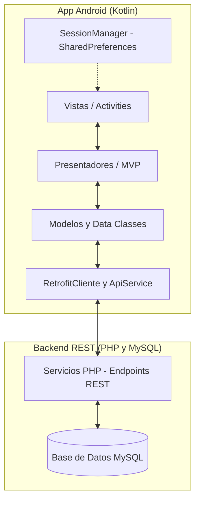
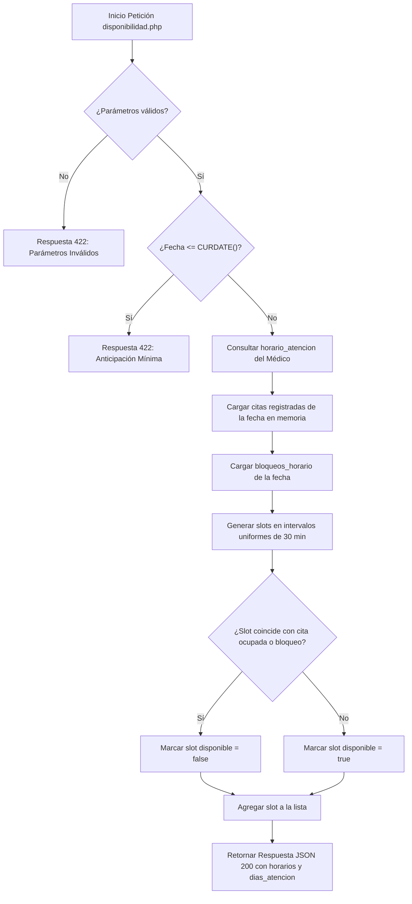
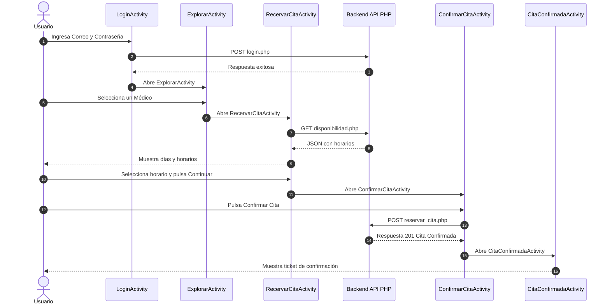

# Documentación Técnica Integral del Proyecto MedicDate

## 1. Resumen del Proyecto

**MedicDate** es una solución tecnológica médica integral compuesta por una aplicación móvil nativa Android (desarrollada en Kotlin) y un backend de servicios RESTful (desarrollado en PHP con MySQL/MariaDB).

La plataforma permite a los pacientes consultar especialidades médicas, explorar la disponibilidad de doctores, visualizar y agendar citas en tiempo real, recibir confirmaciones e interactuar con su perfil de usuario de forma segura e intuitiva.

---

## 2. Arquitectura del Sistema

La aplicación Android sigue el patrón de diseño **Model-View-Presenter (MVP)**, separando la interfaz de usuario de la lógica de negocio e interacción con los servicios web.



### Principios Arquitectónicos
- **Desacoplamiento Estructural**: Separación estricta de las clases de datos (`data*.kt`) respecto a la lógica de negocio (`cls*Modelo.kt`).
- **Comunicación Asíncrona**: Uso de **Kotlin Coroutines** (`Dispatchers.IO` y `Dispatchers.Main`) para peticiones de red sin bloquear la interfaz.
- **Serialización Rápida**: Uso de **Kotlinx Serialization** para el mapeo estricto JSON <-> Data Class.
- **Sin Caché HTTP en Tiempo Real**: Configuración de `OkHttpClient` con interceptor `no-cache` para garantizar la actualización en tiempo real de la disponibilidad médica.

---

## 3. Módulos del Proyecto Android

### 3.1 Vistas y Pantallas (`com.example.medicdate.Vista`)

| Activity / Pantalla | Descripción y Responsabilidad |
| :--- | :--- |
| `LoginActivity.kt` | Autenticación de usuario. Guarda la sesión activa (`id_usuario` e `id_paciente`) en `SessionManager`. |
| `RegistroActivity.kt` | Registro de nuevos pacientes en el sistema con datos personales y credenciales. |
| `ExplorarActivity.kt` | Dashboard principal. Muestra saludo del paciente, próxima cita activa, catálogo de especialidades y lista de médicos. |
| `MedicosEspecialidadActivity.kt` | Muestra los médicos filtrados por una especialidad médica específica. |
| `RecervarCitaActivity.kt` | Pantalla interactiva de selección de citas. Incluye cabecera dinámica del doctor, conmutador de tipo de atención, calendario semanal inteligente (`WeekSwipeLayout`), cargador esqueleto (Skeleton Shadow Load) y cuadrícula de horarios. |
| `ConfirmarCitaActivity.kt` | Resumen pre-reserva de la cita (doctor, fecha, hora, consultorio) con botón de confirmación final. |
| `CitaConfirmadaActivity.kt` | Pantalla de confirmación exitosa con detalles de la cita agendada e ID de ticket. |
| `CuentaActivity.kt` | Información del perfil del paciente y opción de cierre de sesión. |

---

### 3.2 Componente Personalizado: `WeekSwipeLayout`

Ubicación: `com.example.medicdate.UI.WeekSwipeLayout`

#### Características Clave:
1. **Filtro de Días de Atención**: Lee los días en los que el médico atiende (`dias_atencion` ej. `[1, 3, 5]` para Lunes, Miércoles y Viernes). Los días en los que el doctor no atiende se deshabilitan visualmente (`alpha = 0.35f`, `isEnabled = false`).
2. **Restricción de Fechas Pasadas**: Deshabilita y bloquea automáticamente cualquier día menor o igual a la fecha actual (`fecha <= CURDATE()`).
3. **Selección Autonómica del Primer Día Hábil**: Al cargar un médico o cambiar de semana, el componente posiciona el foco en el primer día futuro disponible.
4. **Sincronización del Encabezado**: Sincroniza la etiqueta de rango de fechas (*ej. "23–29 nov 2026"*) con la semana activa del día seleccionado.
5. **Gesto Deslizable (Swipe)**: Soporta gestos táctiles a la izquierda y derecha para cambiar de semana suavemente.

---

### 3.3 Modelos de Datos (`com.example.medicdate.Modelo`)

Los modelos están strictly separados en archivos de datos serializables:

- `dataExplorar.kt`: Clases `dataExplorar`, `Paciente`, `ProximaCita`, `Especialidad`, `MedicoExplorar`.
- `dataMedicosEspecialidad.kt`: Clases `dataMedicosEspecialidad`, `MedicoEspecialidad`, `HorarioResumen`.
- `dataDisponibilidad.kt`: Clases `DisponibilidadRequest` y `DisponibilidadResponse`.
- `dataReserva.kt`: Clases `ReservaRequest`, `ReservaResponse` y `CitaDetalleReserva`.
- `dataCita.kt`: Clases `CitaPaciente` y `DetalleCita`.
- `Horario.kt`: Estructura de slot de horario individual con propiedades `inicio`, `fin`, `hora`, `disponible`, `consultorio`.
- `dataLogin.kt` / `dataRegistro.kt` / `dataCuenta.kt`: Credenciales y datos del usuario.

---

### 3.4 Capa de Red y Persistencia

#### `RetrofitCliente.kt`
Configuración centralizada de Retrofit 2 con conversor de Kotlinx Serialization y cliente OkHttp.
```kotlin
private val okHttpClient: OkHttpClient by lazy {
    OkHttpClient.Builder()
        .addInterceptor(Interceptor { chain ->
            val request = chain.request().newBuilder()
                .header("Cache-Control", "no-cache, no-store, must-revalidate")
                .header("Pragma", "no-cache")
                .build()
            chain.proceed(request)
        })
        .build()
}
```

#### `SessionManager.kt`
Manejador de sesión persistente basado en `SharedPreferences`. Almacena de forma permanente `usuarioId`, `pacienteId` y el token de autenticación para garantizar que la sesión se preserve tras reiniciar la aplicación.

---

## 4. Backend REST (Servicios PHP & Base de Datos)

Base de Datos: `innegone_bd_medicdate` (MySQL / MariaDB)

### 4.1 Catálogo de Endpoints PHP (`/web/apis/movile/medicdate_api/`)

| Archivo PHP | Método | Parámetros de Entrada | Descripción |
| :--- | :--- | :--- | :--- |
| `login.php` | `POST` | `{"correo": "...", "clave": "..."}` | Autentica el usuario y retorna `id_usuario` e `id_paciente`. |
| `registro.php` | `POST` | `nombres`, `apellidoPaterno`, `correo`, `telefono`, `clave` | Registra una nueva persona, usuario y paciente en la BD. |
| `explorar.php` | `GET` | `?idPaciente=X` | Retorna bienvenida del paciente, próxima cita activa, especialidades y doctores. |
| `medicos_especialidad.php` | `GET` | `?idEspecialidad=X` | Retorna los médicos asociados a la especialidad especificada. |
| `disponibilidad.php` | `GET` / `POST` | `?datos={"id_empleado":X, "id_tipo_atencion":Y, "fecha":"YYYY-MM-DD", "id_usuario":Z}` | Genera la lista de slots de horarios para la fecha solicitada. Verifica conflictos de agenda del doctor, paciente y consultorio. |
| `reservar_cita.php` | `POST` | `{"id_usuario":X, "id_empleado":Y, "id_tipo_atencion":Z, "inicio":"YYYY-MM-DD HH:mm:ss"}` | Transacción SQL atómica (`FOR UPDATE`) que registra la cita, notificaciones e historial. |
| `citas_paciente.php` | `GET` | `?id_usuario=X` | Lista las citas próximas e historial de un paciente. |
| `detalle_cita.php` | `GET` | `?id_cita=X&id_usuario=Y` | Obtiene la información detallada de una cita específica. |
| `obtener_cuenta.php` | `GET` | `?idUsuario=X` | Devuelve la información de perfil del usuario. |

---

### 4.2 Lógica de Cálculo de Disponibilidad (`disponibilidad.php`)



---

## 5. Diagrama de Flujo de Navegación del Usuario



---

## 6. Decisiones Técnicas y Soluciones Destacadas

- **Interferencia de Caché HTTP Solucionada**: Se inyectaron encabezados de control de caché (`no-cache, no-store, must-revalidate`) tanto en la app Android (vía OkHttp Interceptor) como en las APIs de PHP. Esto erradicó el problema donde citas recién reservadas continuaban mostrándose como disponibles debido al almacenamiento en caché local del dispositivo.
- **Estandarización Interna de 30 Minutos**: Aunque la interfaz muestre etiquetas como *"Seguimiento · 20 min"*, el motor de disponibilidad y reservas procesa todos los slots e intervalos internos en bloques uniformes de **30 minutos**. Esto garantiza una cuadrícula simétrica sin desfasamientos de horarios.
- **Aislamiento de Desplazamiento (Scroll)**: Se eliminó el `ScrollView` global en la pantalla de reserva. La cabecera superior y el botón de acción inferior permanecen fijos, logrando que únicamente el contenedor de horarios (`rvHorarios`) tenga desplazamiento vertical independiente.
- **Carga Esqueleto (Skeleton Shadow Load)**: Mientras la solicitud de disponibilidad se encuentra en vuelo, la pantalla despliega un contenedor esqueleto parpadeante (`AlphaAnimation`), el cual se oculta únicamente cuando los horarios han finalizado su renderizado.
